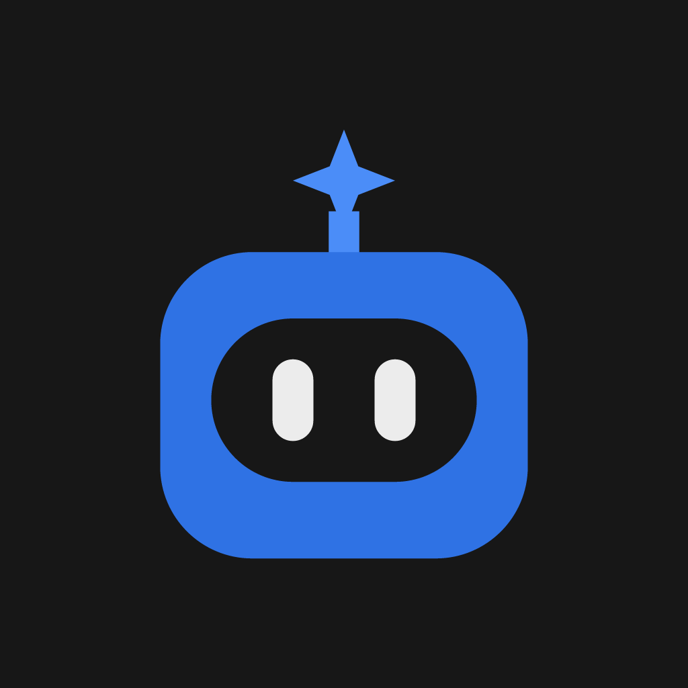

# SuperBot brand

A small guide for the SuperBot mark. Everything here is original work, released under the repo's MIT license. No third-party logos, fonts or artwork are used.



## The mark

A friendly bot head with a spark antenna: a rounded blue head, a dark visor and two upright eyes. It is built from rectangles and one four-point star on a 100 × 100 grid, so it stays crisp from a 16 px favicon to a billboard.

| File | Use |
|------|-----|
| [`apps/client/assets/brand/mark.svg`](../apps/client/assets/brand/mark.svg) | Full-color mark, transparent background. The source of truth. |
| [`apps/client/assets/brand/mark-mono.svg`](../apps/client/assets/brand/mark-mono.svg) | One-color silhouette (visor cut out). Android monochrome icon, notifications, print. |

There is no wordmark artwork yet. Set the name in text next to the mark (see typography).

## Colors

| Name | Hex | Use |
|------|-----|-----|
| Ink | `#171717` | Backgrounds, splash, adaptive icon, visor |
| Night | `#0d0d0d` | Deeper surfaces (sidebar) |
| SuperBot Blue | `#2f72e4` | Bot head, primary actions |
| Sky | `#4b8df8` | Spark antenna, highlights, links |
| Paper | `#ececec` | Eyes, text on dark |

These match the client theme (`apps/client/src/theme.ts`) and the web admin (`web/styles.css`). The mark is designed for dark backgrounds; on light backgrounds place it on an Ink tile (like the favicon).

## Typography

Use the system UI font stack the apps already use: `-apple-system, BlinkMacSystemFont, "Segoe UI", sans-serif`. For marketing, [Inter](https://github.com/rsms/inter) (SIL Open Font License) is a good match. Write the name as **SuperBot**: one word, capital S and B. Never use a licensed or proprietary typeface in shipped assets.

## Clear space and size

- Keep clear space around the mark equal to the **visor height** (32 % of the mark's grid) on all sides.
- Minimum size: 16 px (favicon) on screen, 10 mm in print. Below 24 px, use it on an Ink tile.
- App icons follow platform safe zones: the mark fills 74 % of the iOS icon and sits inside the 66/108 safe circle on Android adaptive icons.

## Do

- Use the SVG sources, or the generated PNGs.
- Use Ink or a very dark neutral behind the full-color mark.
- Use the mono mark when only one color is possible.

## Don't

- Stretch, rotate, outline, add shadows or recolor the parts of the mark.
- Put the full-color mark on busy photos or mid-tone backgrounds.
- Combine the mark with other companies' logos or trademarks, or imply endorsement.
- Call the product anything other than SuperBot.

## Generated assets

All raster assets are rendered from the SVGs by [`apps/client/scripts/brand.mjs`](../apps/client/scripts/brand.mjs) using [resvg](https://github.com/linebender/resvg) (MPL-2.0, via `@resvg/resvg-js`). Edit the SVGs, then run:

```bash
cd apps/client
npm run brand        # regenerate PNGs and the web admin favicon
npm run brand:check  # CI: sizes, no-alpha icons, pixels match the SVGs, app.json wiring
```

| Output | Size | Notes |
|--------|------|-------|
| `assets/images/icon.png` | 1024 × 1024 | iOS / Expo app icon, opaque (no alpha) |
| `assets/images/android-icon-foreground.png` | 1024 × 1024 | Adaptive icon foreground, transparent |
| `assets/images/android-icon-background.png` | 1024 × 1024 | Adaptive icon background, solid Ink |
| `assets/images/android-icon-monochrome.png` | 1024 × 1024 | Android 13+ themed icon |
| `assets/images/splash-icon.png` | 1024 × 1024 | Splash image on Ink, shown at 200 dp |
| `assets/images/favicon.png` | 48 × 48 | Expo web favicon |
| `assets/brand/store/play-store-icon.png` | 512 × 512 | Google Play listing icon |
| `assets/brand/store/feature-graphic.png` | 1024 × 500 | Google Play feature graphic |
| `web/index.html` | SVG | Inline favicon for the web admin UI |

The client has no notification icon yet; when push lands (M3), generate one from `mark-mono.svg` the same way.
