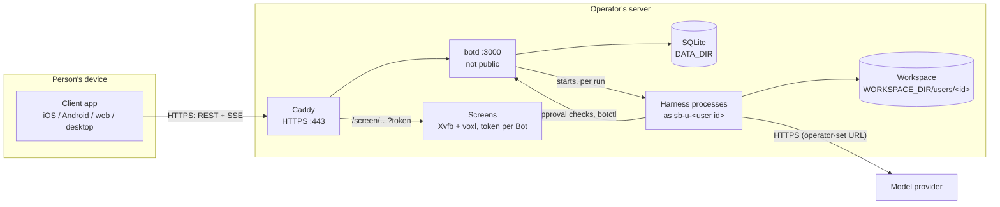
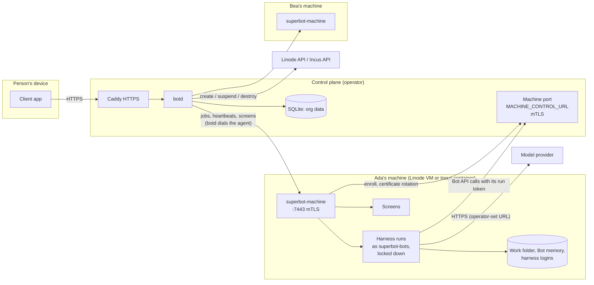
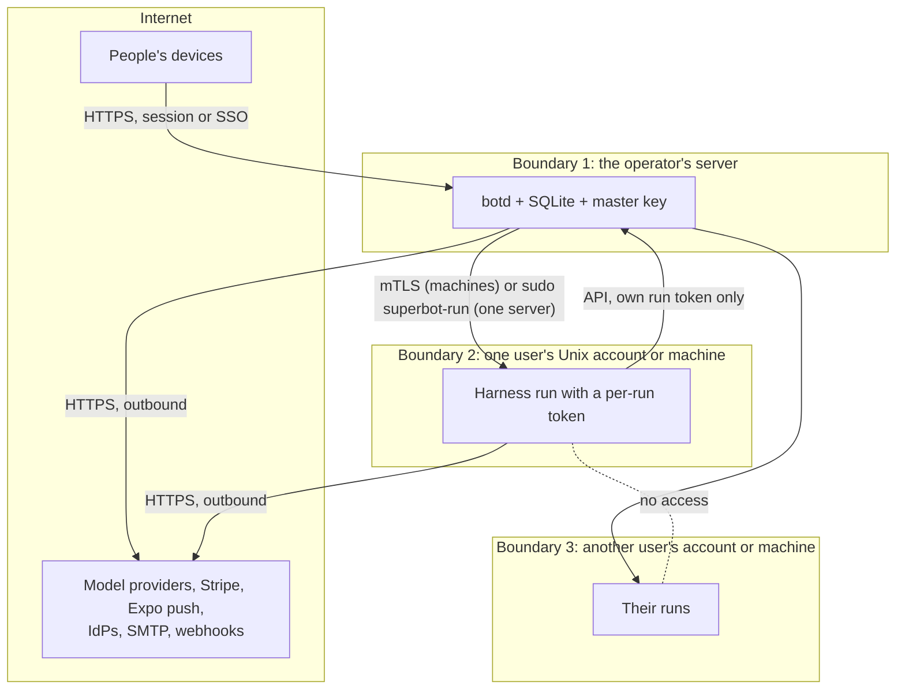

# Architecture

SuperBot gives each person AI teammates ("Bots") that work on a computer. SuperBot does not have its own agent loop: each Bot runs an existing agent CLI (a "harness"), and SuperBot decides who may run what, where, and with which approvals.

Part of the [security pack](README.md). Data stored by each part: [data flows](data-flows.md).

## Components

| Component | What it is | Where it runs |
|-----------|-----------|---------------|
| **botd** | The server (Rust, one binary). Users, sign-in, Bots, chats, routines, approvals, policy, secrets, audit log, billing, and, when on, the control plane for managed machines. Stores its data in SQLite. | The operator's server. |
| **Caddy** | Reverse proxy. Terminates HTTPS, serves the web client at `/app/` and the landing page, and forwards everything else to botd on port 3000, which is never public ([ADR 0013](../adr/0013-serve-web-client.md)). With the systemd install, botd listens only on `127.0.0.1:3000`. With Docker Compose, botd listens on `0.0.0.0:3000` inside its container; that port is not published to the host, and the only other container on its network is Caddy ([ADR 0006](../adr/0006-docker-compose.md), [`docker-compose.yml`](../../deploy/docker/docker-compose.yml)). | Same server, in front of botd ([`deploy/install.sh`](../../deploy/install.sh), [`deploy/docker/`](../../deploy/docker/)). |
| **Client app** | Expo app for iOS, Android, web and desktop (Electron). Chat, approvals, Bot screens, settings, admin views. Talks to botd only, over HTTPS (REST plus server-sent events) ([ADR 0004](../adr/0004-client-expo.md), [ADR 0027](../adr/0027-expo-primary-hermes-default.md)). | The person's device. |
| **Admin console** | A minimal admin page served by botd at `/console/`, for admins only ([ADR 0032](../adr/0032-console-admin-only.md)). | Browser. |
| **Harnesses** | The agent CLIs a Bot runs: Claude Code, Codex, Pi and Hermes Agent. One adapter each in botd ([`server/src/adapters/`](../../server/src/adapters/)); nothing else in SuperBot knows which harness runs. Hermes Agent is the default on managed plans ([ADR 0079](../adr/0079-hermes-default-for-managed-tiers.md)). | Wherever the Bot's owner's runs go: the botd server, or the owner's machine. |
| **botctl** | CLI for operators and for Bots (routines, ask, handoff, approval checks). Talks to botd's API. | The server, and each machine. |
| **superbot-run** | Small helper that starts a harness as the user's own Unix account on the server ([ADR 0037](../adr/0037-per-user-unix-accounts.md), [ADR 0058](../adr/0058-harness-os-user-by-default.md)). | The botd server. |
| **Machine agent** (`superbot-machine`) | Runs on each user's managed machine. Enrolls once, then takes jobs from botd over mutual TLS: run a harness, install or upgrade harnesses, harness logins, folder copy, screens, teammates' OS users ([ADR 0031](../adr/0031-machine-enrollment-mtls.md), [ADR 0036](../adr/0036-bots-on-the-users-machine.md)). | Each user's machine. |
| **Screens** | A Bot's own Linux desktop: Xvfb, Openbox, Chromium and the voxl viewer, which needs a per-Bot token ([ADR 0003](../adr/0003-computer.md), [ADR 0008](../adr/0008-client-screen-auth.md), [ADR 0045](../adr/0045-screens-on-machines.md)). The viewer listens on loopback, except under Docker Compose, where it listens on the unpublished container network so Caddy can reach it (`SCREEN_ADDR=0.0.0.0`). Screens on the server are off while per-user accounts are on ([ADR 0084](../adr/0084-published-image-with-computer-use.md)). | The botd server, or the owner's machine (`MACHINE_SCREENS=on`, which needs the Bots' own user). |
| **Per-user machines** | One computer per user: a Linode VM ([ADR 0025](../adr/0025-control-plane-linode.md)) or an unprivileged Incus system container ([ADR 0065](../adr/0065-incus-container-machines.md)), placed across several Incus hosts by load ([ADR 0081](../adr/0081-placing-machines-by-host-load.md)). | The operator's Linode account, or the operator's Incus hosts. |
| **superbot-license** | Offline tool that signs self-host licence keys ([ADR 0038](../adr/0038-self-host-license-key.md)). | CG-Labs only. Never on a customer server. |

## Deployment modes

### One server (self-host)

Everything runs on one Linux server, installed with [`deploy/install.sh`](../../deploy/install.sh) (systemd) or [Docker Compose](../../deploy/docker/). Each user's Bots run as that user's own Unix account (`sb-u-<user id>`), which can't read botd's files, the database or the master key ([ADR 0058](../adr/0058-harness-os-user-by-default.md); on by default for new installs, both systemd and Compose).

Compose pulls published images (`ghcr.io/cg-labs/superbot` and `ghcr.io/cg-labs/superbot-caddy`, amd64 and arm64), or builds them from the checkout. CI builds the published images from this repository and smoke-tests them on both architectures before pushing them. CI scans each image for known vulnerabilities, signs each published image keylessly with cosign and attaches signed build provenance and an SBOM, which operators can verify ([ADR 0101](../adr/0101-image-scanning-and-signing.md), [verifying the images](../../deploy/README.md#verifying-the-images)). Containers drop all Linux capabilities except the few each needs (botd: those that start per-user runs; Caddy: binding ports 80 and 443), and sudo is the image's only setuid program. Chromium keeps its own sandbox inside the container: botd's container gets Docker's seccomp profile plus the user, PID and network namespaces the sandbox needs, and the image's `chromium` refuses agent-browser's `--no-sandbox`. botd logs at start whether it works; `SUPERBOT_CHROMIUM_SANDBOX=off` turns it off for hosts that can't, with a warning ([ADR 0107](../adr/0107-chromium-sandbox-in-the-container.md)).

### Managed (control plane and one machine per user)

The same botd, with the control plane turned on (`LINODE_TOKEN`, or `MACHINE_PROVIDER=incus`; off by default). botd creates one machine per user, and with `MACHINE_ROUTING` on, each Bot runs on its **owner's** machine and nowhere else. A run that can't go there is refused, never run on the server instead ([ADR 0036](../adr/0036-bots-on-the-users-machine.md)).

Key points:

- **The control plane decides; the machine does.** Who may see or run a Bot, approvals, policy, secrets, billing and the audit log stay in botd. A compromised machine can harm only its own user ([ADR 0029](../adr/0029-per-user-isolation.md)).
- **botd dials the agent.** Jobs, heartbeats, logins and screens go from botd to the agent's port (default 7443). The agent calls botd only to enroll, to rotate its certificate, and to relay a running Bot's own API calls.
- **Runs as an unprivileged, locked-down user, by default.** The agent (which stays root) runs every harness as the unprivileged `superbot-bots` user ([ADR 0043](../adr/0043-bots-own-os-user-on-machines.md)). Every process it starts as a Bots' or teammate's user can't gain privileges again (no sudo, su, setuid programs or file capabilities), keeps its files to itself (umask 077, its own temporary folder), and is killed before the agent when memory runs out; the agent refuses a run user in a privileged group or with a sudo rule, and runs can't see other users' processes. A red-team suite in CI tries each way out as root and checks it fails ([ADR 0145](../adr/0145-locked-down-run-users-and-red-team.md)). `MACHINE_BOT_USER=off` runs Bots as root, like the agent, so they can read its key; botd warns at every start. `MACHINE_TEAMMATE_USERS` (off by default; needs the Bots' own user) runs a teammate's runs of a shared Bot as that teammate's own OS user. Without it, those runs share the owner's Bots' user and home, so their tools can read the owner's folder and harness logins ([ADR 0048](../adr/0048-teammates-own-os-user-on-machines.md)). Screens need the Bots' own user.
- **Hardened at first boot, on by default.** Before the agent installs, a new or rebuilt machine locks SSH to root with a key and no forwarding, sets kernel hardening sysctls, turns on unattended security updates that never reboot by themselves, and loads egress rules: every user but root and the OS's network daemons (so every Bot and teammate user, even one made later) is refused at private, shared, link-local and cloud metadata addresses and at `MACHINE_EGRESS_DENY`. The rules bind Bots unless `MACHINE_BOT_USER=off`. The agent reports each step and botd audits a change (`MACHINE_HARDENING=off` opts out; [ADR 0126](../adr/0126-per-user-machine-hardening.md)).
- **Each run held to limits, and outbound optionally allow-listed.** Each Bot run gets a cgroup of its own, held to its tier's share of the machine's CPUs and memory, a process cap and an IO weight, so one run can't starve the agent or other runs (`MACHINE_RUN_LIMITS`, on by default). Admins can set an outbound allow-list for every machine or one user's: Bots then reach only listed hosts and networks, on top of the deny rules, and runs wait until it is loaded. Both are reported by the agent and audited ([ADR 0135](../adr/0135-run-limits-and-egress-allow-lists.md)).
- **No harness code on the agent.** botd's adapters build each run's command and send it as data; the agent runs it ([ADR 0036](../adr/0036-bots-on-the-users-machine.md)).

## Trust boundaries

| Boundary | What crosses it | How it is guarded |
|----------|-----------------|-------------------|
| Device to server | People's requests | HTTPS at Caddy; session cookie (`__Host-`, HttpOnly, Secure, SameSite=Strict) or bearer token; same-origin check on writes; sign-in rate limit; roles and Bot permissions on every route ([access control](access-control.md)). |
| Server to a run | A run's command, environment and secrets | One server: the run is the user's own Unix account, started through `sudo superbot-run`. Machines: mutual TLS with pinned certificates from botd's own CA. |
| A run back to the server | A Bot's API calls (botctl, approval checks) | A token for that run only, revoked when the run ends; a Bot can do no more than its owner ([ADR 0083](../adr/0083-per-run-tokens.md)). |
| User to user | Nothing | Separate folders, Unix accounts or machines; ACL checks in botd; isolation tests in CI ([`deploy/test-isolation.sh`](../../deploy/test-isolation.sh)). |
| Machine to network | Inbound and outbound traffic | Linode: only with `MACHINE_FIREWALL=on` (off by default), a Cloud Firewall drops all inbound except botd to the agent port (SSH only if the operator lists sources). Without it, a new Linode is open to the internet (SSH, the agent port, anything listening); the agent port still requires mutual TLS ([ADR 0035](../adr/0035-machine-firewall-auto-enroll.md)). Incus: botd refuses to start without `MACHINE_FIREWALL=on`, and containers can't reach each other, the host, or private and link-local ranges ([ADR 0065](../adr/0065-incus-container-machines.md)). Inside every machine hardened at first boot (on by default), Bots' and teammates' users can't reach private, shared, link-local or metadata addresses, while public addresses stay open ([ADR 0126](../adr/0126-per-user-machine-hardening.md)). Linode's firewall also drops outbound TCP and UDP to the same list from the whole machine, root included, unless `MACHINE_FIREWALL_EGRESS=off`; Linode never filters its metadata service, so only the in-machine rules keep users other than root off it ([ADR 0179](../adr/0179-outbound-rules-at-the-provider.md)). With `MACHINE_TEAM_NETWORK=vpc`, a team's Linodes also sit on a VPC of the team's own; both sets of rules let its subnet through, VPCs never route to each other, and inbound stays dropped there, so a machine reaches its team's services and no other team's network, nor its teammates' machines ([ADR 0189](../adr/0189-a-network-of-its-own-per-team.md)). With an outbound allow-list set, they reach only its hosts and networks ([ADR 0135](../adr/0135-run-limits-and-egress-allow-lists.md)). |
| Server to outside services | API calls | HTTPS with certificate checks; each service is off until its setting is set ([subprocessors](subprocessors.md)). |

## Planned

- Hardening and run limits for machines enrolled before ADR 0126 and ADR 0135 without a rebuild, dedicated or VPC hosts, and the red-team exercise (M5, [ADR 0126](../adr/0126-per-user-machine-hardening.md), [ADR 0135](../adr/0135-run-limits-and-egress-allow-lists.md)).
- Encrypted assertions, signed AuthnRequests and single logout for native SAML (M5, [ADR 0127](../adr/0127-native-saml-service-provider.md)).
- Write-once storage for exported audit events (M5; the hash chain and SIEM export are done, [ADR 0122](../adr/0122-siem-export-and-tamper-evident-audit.md)).
- A read-only root filesystem for the containers ([ADR 0084](../adr/0084-published-image-with-computer-use.md)).
