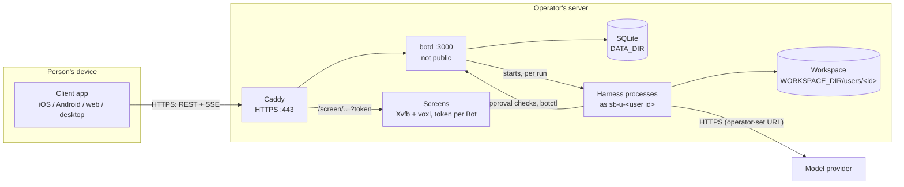
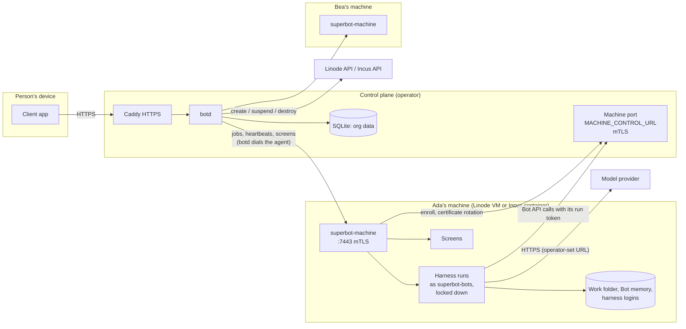
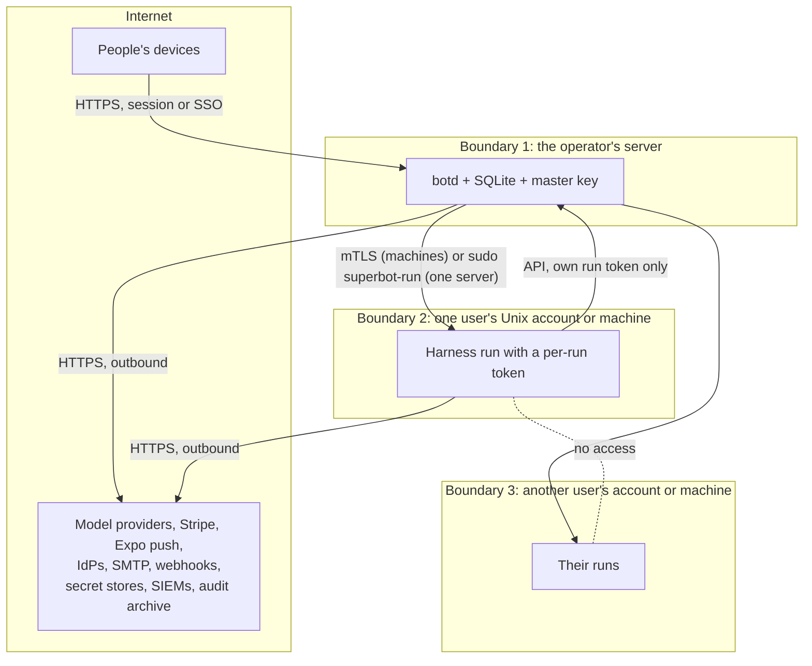

# Architecture

SuperBot gives each person AI teammates ("Bots") that work on a computer. SuperBot does not have its own agent loop: each Bot runs an existing agent CLI (a "harness"), and SuperBot decides who may run what, where, and with which approvals.

Part of the [security pack](README.md). Data stored by each part: [data flows](data-flows.md).

## Components

| Component | What it is | Where it runs |
|-----------|-----------|---------------|
| **botd** | The server (Rust, one binary). Users, sign-in (including the native SAML service provider), Bots, chats, routines, approvals, policy, secrets, audit log and its export, billing, and, when on, the control plane for managed machines. Stores its data in SQLite, plus, for people under a residency pin, a SQLite store per region ([enterprise integrations](#enterprise-integrations)). | The operator's server. |
| **Caddy** | Reverse proxy. Terminates HTTPS, serves the web client at `/app/` and the landing page, and forwards everything else to botd on port 3000, which is never public ([ADR 0013](../adr/0013-serve-web-client.md)). With the systemd install, botd listens only on `127.0.0.1:3000`. With Docker Compose, botd listens on `0.0.0.0:3000` inside its container; that port is not published to the host, and the only other container on its network is Caddy ([ADR 0006](../adr/0006-docker-compose.md), [`docker-compose.yml`](../../deploy/docker/docker-compose.yml)). | Same server, in front of botd ([`deploy/install.sh`](../../deploy/install.sh), [`deploy/docker/`](../../deploy/docker/)). |
| **Client app** | Expo app for iOS, Android, web and desktop (Electron). Chat, approvals, Bot screens, settings, admin views. Talks to botd only, over HTTPS (REST plus server-sent events) ([ADR 0004](../adr/0004-client-expo.md), [ADR 0027](../adr/0027-expo-primary-hermes-default.md)). | The person's device. |
| **Admin console** | A minimal admin page served by botd at `/console/`, for admins only ([ADR 0032](../adr/0032-console-admin-only.md)). | Browser. |
| **Harnesses** | The agent CLIs a Bot runs: Claude Code, Codex, Pi and Hermes Agent. One adapter each in botd ([`server/src/adapters/`](../../server/src/adapters/)); nothing else in SuperBot knows which harness runs. Hermes Agent is the default on managed plans ([ADR 0079](../adr/0079-hermes-default-for-managed-tiers.md)). | Wherever the Bot's owner's runs go: the botd server, or the owner's machine. |
| **botctl** | CLI for operators and for Bots (routines, ask, handoff, approval checks). Talks to botd's API. | The server, and each machine. |
| **superbot-run** | Small helper that starts a harness as the user's own Unix account on the server ([ADR 0037](../adr/0037-per-user-unix-accounts.md), [ADR 0058](../adr/0058-harness-os-user-by-default.md)). | The botd server. |
| **Machine agent** (`superbot-machine`) | Runs on each user's managed machine. Enrolls once, then takes jobs from botd over mutual TLS: run a harness, install or upgrade harnesses, harness logins, folder copy, screens, teammates' OS users ([ADR 0031](../adr/0031-machine-enrollment-mtls.md), [ADR 0036](../adr/0036-bots-on-the-users-machine.md)). | Each user's machine. |
| **Screens** | A Bot's own Linux desktop: Xvfb, Openbox, Chromium and the voxl viewer, which needs a per-Bot token ([ADR 0003](../adr/0003-computer.md), [ADR 0008](../adr/0008-client-screen-auth.md), [ADR 0045](../adr/0045-screens-on-machines.md)). The viewer listens on loopback, except under Docker Compose, where it listens on the unpublished container network so Caddy can reach it (`SCREEN_ADDR=0.0.0.0`). Screens on the server are off while per-user accounts are on ([ADR 0084](../adr/0084-published-image-with-computer-use.md)). | The botd server, or the owner's machine (`MACHINE_SCREENS=on`, which needs the Bots' own user). |
| **Per-user machines** | One computer per user: a Linode VM ([ADR 0025](../adr/0025-control-plane-linode.md)) or an unprivileged Incus system container ([ADR 0065](../adr/0065-incus-container-machines.md)), placed across several Incus hosts by load ([ADR 0081](../adr/0081-placing-machines-by-host-load.md)). | The operator's Linode account, or the operator's Incus hosts. |
| **superbot-license** | Offline tool that signs self-host licence keys ([ADR 0038](../adr/0038-self-host-license-key.md)). | CG-Labs only. Never on a customer server. |

## Deployment modes

### One server (self-host)

Everything runs on one Linux server, installed with [`deploy/install.sh`](../../deploy/install.sh) (systemd) or [Docker Compose](../../deploy/docker/). Each user's Bots run as that user's own Unix account (`sb-u-<user id>`), which can't read botd's files, the database or the master key ([ADR 0058](../adr/0058-harness-os-user-by-default.md); on by default for new installs, both systemd and Compose).

Compose pulls published images (`ghcr.io/cg-labs/superbot` and `ghcr.io/cg-labs/superbot-caddy`, amd64 and arm64), or builds them from the checkout. CI builds the published images from this repository and smoke-tests them on both architectures before pushing them. CI scans each image for known vulnerabilities, signs each published image keylessly with cosign and attaches signed build provenance and an SBOM, which operators can verify ([ADR 0101](../adr/0101-image-scanning-and-signing.md), [verifying the images](../../deploy/README.md#verifying-the-images)). Containers drop all Linux capabilities except the few each needs (botd: those that start per-user runs; Caddy: binding ports 80 and 443), and sudo is the image's only setuid program. Chromium keeps its own sandbox inside the container: botd's container gets Docker's seccomp profile plus the user, PID and network namespaces the sandbox needs, and the image's `chromium` refuses agent-browser's `--no-sandbox`. botd logs at start whether it works; `SUPERBOT_CHROMIUM_SANDBOX=off` turns it off for hosts that can't, with a warning ([ADR 0107](../adr/0107-chromium-sandbox-in-the-container.md)).

### Managed (control plane and one machine per user)

The same botd, with the control plane turned on (`LINODE_TOKEN`, or `MACHINE_PROVIDER=incus`; off by default). botd creates one machine per user, and with `MACHINE_ROUTING` on, each Bot runs on its **owner's** machine and nowhere else. A run that can't go there is refused, never run on the server instead ([ADR 0036](../adr/0036-bots-on-the-users-machine.md)).

Key points:

- **The control plane decides; the machine does.** Who may see or run a Bot, approvals, policy, secrets, billing and the audit log stay in botd. A compromised machine can harm only its own user ([ADR 0029](../adr/0029-per-user-isolation.md)).
- **botd dials the agent.** Jobs, heartbeats, logins and screens go from botd to the agent's port (default 7443). The agent calls botd only to enroll, to rotate its certificate, and to relay a running Bot's own API calls.
- **Runs as an unprivileged, locked-down user, by default.** The agent (which stays root) runs every harness as the unprivileged `superbot-bots` user ([ADR 0043](../adr/0043-bots-own-os-user-on-machines.md)). Every process it starts as a Bots' or teammate's user can't gain privileges again (no sudo, su, setuid programs or file capabilities), keeps its files to itself (umask 077, its own temporary folder), and is killed before the agent when memory runs out; the agent refuses a run user in a privileged group or with a sudo rule, and runs can't see other users' processes. A red-team suite in CI tries each way out as root and checks it fails ([ADR 0145](../adr/0145-locked-down-run-users-and-red-team.md)). `MACHINE_BOT_USER=off` runs Bots as root, like the agent, so they can read its key; botd warns at every start. `MACHINE_TEAMMATE_USERS` (off by default; needs the Bots' own user) runs a teammate's runs of a shared Bot as that teammate's own OS user. Without it, those runs share the owner's Bots' user and home, so their tools can read the owner's folder and harness logins ([ADR 0048](../adr/0048-teammates-own-os-user-on-machines.md)). Screens need the Bots' own user.
- **Hardened at first boot, on by default.** Before the agent installs, a new or rebuilt machine locks SSH to root with a key and no forwarding, sets kernel hardening sysctls, turns on unattended security updates that never reboot by themselves, and loads egress rules: every user but root and the OS's network daemons (so every Bot and teammate user, even one made later) is refused at private, shared, link-local and cloud metadata addresses and at `MACHINE_EGRESS_DENY`. The rules bind Bots unless `MACHINE_BOT_USER=off`. The agent reports each step and botd audits a change (`MACHINE_HARDENING=off` opts out; [ADR 0126](../adr/0126-per-user-machine-hardening.md)).
- **Each run held to limits, and outbound optionally allow-listed.** Each Bot run gets a cgroup of its own, held to its tier's share of the machine's CPUs and memory, a process cap and an IO weight, so one run can't starve the agent or other runs (`MACHINE_RUN_LIMITS`, on by default). Admins can set an outbound allow-list for every machine or one user's: Bots then reach only listed hosts and networks, on top of the deny rules, and runs wait until it is loaded. Both are reported by the agent and audited ([ADR 0135](../adr/0135-run-limits-and-egress-allow-lists.md)).
- **No harness code on the agent.** botd's adapters build each run's command and send it as data; the agent runs it ([ADR 0036](../adr/0036-bots-on-the-users-machine.md)).

### Air-gapped (self-host with no internet)

The same one-server or Incus setup, on a network with no internet access ([ADR 0128](../adr/0128-air-gapped-self-host.md), [guide](../ops/air-gapped.md)). The operator makes or downloads an **offline bundle** on a connected machine and carries it in. Each tagged release is meant to attach one per arch, signed with cosign ([ADR 0140](../adr/0140-release-bundles-and-registry-mirrors.md), [ADR 0172](../adr/0172-release-bundles-checked-end-to-end.md)); no release has been tagged yet ([roadmap](../ROADMAP.md#finish-line)).

- **Checked before it runs.** `install.sh --offline <bundle>` checks the bundle's SHA-256 or cosign signature, that every file in it is listed in its `SHA256SUMS` with the right hash and nothing else is there, and that it holds no links or paths outside its folder. It refuses a bundle older than the one installed. Nothing on the server then calls GitHub, a package registry, Let's Encrypt or CG-Labs; HTTPS uses the operator's own certificate (`--tls-cert`, `--tls-key`).
- **Harnesses without the internet.** Claude Code, Codex and Pi come from a harness bundle and Hermes Agent from a Hermes bundle, each checked against the versions and hashes the release pins ([ADR 0232](../adr/0232-harness-cli-bundle-for-air-gapped-servers.md), [ADR 0200](../adr/0200-hermes-agent-bundle-for-air-gapped-installs.md)). botd serves the same bundles to users' machines over the machine port's mutual TLS ([ADR 0242](../adr/0242-harness-bundle-on-air-gapped-machines.md), [ADR 0210](../adr/0210-hermes-agent-on-air-gapped-machines.md)), or machines use the operator's own Node.js, npm and Ubuntu mirrors, which can serve the pinned files but not change them ([ADR 0186](../adr/0186-harness-installs-from-internal-mirrors.md), [ADR 0284](../adr/0284-ubuntu-packages-on-machines-from-an-apt-mirror.md)). Images can be copied to an internal registry with their signatures, so `cosign verify` works against the mirror ([ADR 0147](../adr/0147-signatures-and-multi-arch-indexes-in-mirrors.md)).
- **Settings checked for the network.** `botd offline check` lists every address botd's settings name as inside the network, on the internet, or to check, without opening a connection; `botctl offline check` asks the running botd the same, including secrets and SAML metadata it holds, and is audited ([ADR 0257](../adr/0257-checking-settings-for-air-gapped-networks.md), [ADR 0266](../adr/0266-checking-the-running-server-for-air-gapped-networks.md)).
- **Upgrades with a way back.** An offline upgrade first checks the new botd against every setting, machines' settings and the licence, and stops before changing anything if it wouldn't start or would stop Bots that run now. It takes a root-only backup that `--rollback` restores ([ADR 0310](../adr/0310-offline-upgrades-checked-against-every-setting.md), [ADR 0300](../adr/0300-offline-upgrades-keep-a-way-back.md), [ADR 0305](../adr/0305-the-license-through-offline-upgrades.md)). Compose upgrades are checked first and keep a rollback point too ([ADR 0317](../adr/0317-compose-upgrades-checked-first.md), [ADR 0327](../adr/0327-compose-upgrades-keep-a-way-back.md)).
- **What doesn't work offline.** Stripe billing, Expo push, Turnstile and Linode machines need the internet and stay off. Sign-in works with the password, TOTP, or an IdP inside the network. Model providers must be inside the network too, such as a self-hosted model server ([guide](../ops/air-gapped.md#what-needs-the-internet-and-what-to-do-instead)).

## Enterprise integrations

Each is off until the operator turns it on. Data stored and sent by each: [data flows](data-flows.md).

### Native SAML

botd is the SAML 2.0 service provider itself, with no broker ([ADR 0127](../adr/0127-native-saml-service-provider.md), [guide](../sso/saml-native.md)). The person's browser carries the AuthnRequest to the IdP and the signed response back to botd's assertion consumer URL. botd talks to the IdP directly only to fetch its metadata (a URL, a federation's MDQ server or signed aggregate, [ADR 0281](../adr/0281-saml-metadata-from-mdq.md), [ADR 0301](../adr/0301-saml-federation-aggregates.md)), for back-channel (SOAP) logout ([ADR 0208](../adr/0208-saml-back-channel-soap-logout.md)), and, when chosen, to resolve an artifact into the response so the assertion never passes through the browser ([ADR 0268](../adr/0268-saml-artifact-binding.md)). botd's own signing and encryption keys are sealed in its database, or are the operator's own files ([ADR 0137](../adr/0137-saml-signed-requests-and-single-logout.md), [ADR 0150](../adr/0150-saml-encrypted-assertions.md)). The checks it makes are in [access control](access-control.md#authentication).

### External secret stores

botd can read secrets from HashiCorp Vault, Azure Key Vault, GCP Secret Manager or AWS Secrets Manager instead of its own sealed store ([ADR 0125](../adr/0125-external-secrets-backend-vault.md), [ADR 0136](../adr/0136-cloud-secret-managers.md), [ADR 0146](../adr/0146-aws-secrets-manager.md)). The store is read-only to botd and is asked after the environment and before the sealed store, with answers cached in memory only (`SECRETS_CACHE_SECONDS`, 300 by default). It fails closed: botd won't start without it, never serves a stale or a sealed value the store was meant to replace, and refuses Bot runs while it can't answer. botd signs in with its platform identity where it can, so it need hold no credential for the store: Vault's Kubernetes, JWT and cloud methods, Azure managed or workload identity, GCP's metadata server, or AWS's standard credential chain ([ADR 0159](../adr/0159-vault-kubernetes-and-jwt-sign-in.md), [ADR 0260](../adr/0260-vault-cloud-sign-in.md), [ADR 0298](../adr/0298-vault-sign-in-with-the-instances-own-identity.md)). It can also mint short-lived credentials for each run from Vault's dynamic secrets, AWS STS, GCP service account impersonation or Entra app tokens ([ADR 0185](../adr/0185-short-lived-credentials-per-run.md), [ADR 0194](../adr/0194-sts-sessions-for-each-run.md), [ADR 0203](../adr/0203-gcp-service-account-tokens-for-each-run.md), [ADR 0213](../adr/0213-entra-app-tokens-for-each-run.md)). The master key never comes from the store: it stays a file or environment variable on the host ([data flows](data-flows.md#on-the-control-plane-botds-server)).

### Audit export

botd sends every audit event, in order, to up to four SIEMs and a write-once S3 archive at once, each with its own cursor and retries, so one sink's outage doesn't stop another ([ADR 0122](../adr/0122-siem-export-and-tamper-evident-audit.md), [ADR 0173](../adr/0173-an-archive-alongside-a-siem.md), [ADR 0191](../adr/0191-several-siems-with-their-own-headers.md), [guide](../ops/audit-export.md)). SIEMs take JSON lines over HTTPS, syslog over TLS, or the native APIs of Microsoft Sentinel (Azure Monitor), Google SecOps and Datadog, with no collector or agent in between ([ADR 0217](../adr/0217-audit-export-to-azure-monitor.md), [ADR 0237](../adr/0237-audit-export-to-google-secops.md), [ADR 0245](../adr/0245-audit-export-to-datadog.md)). By default the archive locks each object with S3 Object Lock, reads every lock back, and fails the export on a store that doesn't lock; `AUDIT_EXPORT_S3_LOCK=off` makes it a plain bucket ([ADR 0154](../adr/0154-write-once-s3-audit-archive.md)). Every exported line carries its place on the audit log's hash chain, so a copy in a SIEM or the archive can be checked without botd (`botctl audit verify-lines`, [ADR 0199](../adr/0199-self-checking-audit-lines.md)). Exported lines are the audit API's events, scrubbed of secrets when they were written ([data flows](data-flows.md#audit-export)).

### Residency pins

A server admin pins a user or a team to a data region under an agreement reference ([ADR 0129](../adr/0129-contractual-data-residency.md)). Their machines, machine backups, model routes and runs are then held to that region ([ADR 0139](../adr/0139-in-region-model-routes.md), [ADR 0267](../adr/0267-runs-on-a-computer-in-the-pins-region.md)). With `REGION_DATA_DIRS`, each offered region also gets a **regional chat store**: a SQLite file in a folder the operator puts in that region, encrypted with botd's database key, where a pinned person's chats, routines, approvals, Bots' memory, facts, sign-ins, own secrets, second factors, usage records and audit details are kept instead of in botd's own database ([ADR 0215](../adr/0215-pinned-chats-in-a-store-in-their-region.md), [ADR 0316](../adr/0316-audit-details-in-the-regional-store.md)). Each store has its own backups, and optionally copies to a bucket in its region ([ADR 0246](../adr/0246-copying-store-backups-off-the-host-in-their-region.md)). botd itself and the rest of its database (accounts, daily usage, the audit log's sealed rows) stay where the operator runs it; `SERVER_DATA_REGION` states where that is ([ADR 0184](../adr/0184-botds-own-data-region.md), [ADR 0321](../adr/0321-events-about-a-pinned-person-in-their-store.md)).

## Trust boundaries

| Boundary | What crosses it | How it is guarded |
|----------|-----------------|-------------------|
| Device to server | People's requests | HTTPS at Caddy; session cookie (`__Host-`, HttpOnly, Secure, SameSite=Strict) or bearer token; same-origin check on writes; sign-in rate limit; roles and Bot permissions on every route ([access control](access-control.md)). |
| Server to a run | A run's command, environment and secrets | One server: the run is the user's own Unix account, started through `sudo superbot-run`. Machines: mutual TLS with pinned certificates from botd's own CA. |
| A run back to the server | A Bot's API calls (botctl, approval checks) | A token for that run only, revoked when the run ends; a Bot can do no more than its owner ([ADR 0083](../adr/0083-per-run-tokens.md)). |
| User to user | Nothing | Separate folders, Unix accounts or machines; ACL checks in botd; isolation tests in CI ([`deploy/test-isolation.sh`](../../deploy/test-isolation.sh)). |
| Machine to network | Inbound and outbound traffic | Linode: only with `MACHINE_FIREWALL=on` (off by default), a Cloud Firewall drops all inbound except botd to the agent port (SSH only if the operator lists sources). Without it, a new Linode is open to the internet (SSH, the agent port, anything listening); the agent port still requires mutual TLS ([ADR 0035](../adr/0035-machine-firewall-auto-enroll.md)). Incus: botd refuses to start without `MACHINE_FIREWALL=on`, and containers can't reach each other, the host, or private and link-local ranges ([ADR 0065](../adr/0065-incus-container-machines.md)). Inside every machine hardened at first boot (on by default), Bots' and teammates' users can't reach private, shared, link-local or metadata addresses, while public addresses stay open ([ADR 0126](../adr/0126-per-user-machine-hardening.md)). Linode's firewall also drops outbound TCP and UDP to the same list from the whole machine, root included, unless `MACHINE_FIREWALL_EGRESS=off`; Linode never filters its metadata service, so only the in-machine rules keep users other than root off it ([ADR 0179](../adr/0179-outbound-rules-at-the-provider.md)). With `MACHINE_TEAM_NETWORK=vpc`, a team's Linodes also sit on a VPC of the team's own; both sets of rules let its subnet through, VPCs never route to each other, and inbound stays dropped there, so a machine reaches its team's services and no other team's network, nor its teammates' machines ([ADR 0189](../adr/0189-a-network-of-its-own-per-team.md)). An existing machine joins without a rebuild only once its own rules let the subnet through, and loses the subnet from them once it is off the VPC ([ADR 0202](../adr/0202-existing-machines-join-their-teams-network.md)). A Linode with Linode interfaces, the newer kind, takes the firewall on each public and VPC interface and counts as behind it only when every one is; every create names its kind, so an account's default can't leave a machine uncovered ([ADR 0226](../adr/0226-linode-interfaces-behind-the-firewall-and-on-team-networks.md)). With `MACHINE_TEAM_NETWORK=ovn`, a team's Incus containers sit on an isolated OVN network of the team's own, with no uplink, through a second NIC whose ACL lets nothing in and out only to the subnet, with MAC and IP filtering; the subnet is refused if it meets anything containers reach or are kept off through their own NIC ([ADR 0212](../adr/0212-an-ovn-network-per-team-on-incus.md)). A team this server deleted loses its network once nothing at all is on it, and on Incus its ACL and its name on the project's access list too ([ADR 0236](../adr/0236-removing-the-networks-of-teams-that-are-gone.md)). With an outbound allow-list set, they reach only its hosts and networks ([ADR 0135](../adr/0135-run-limits-and-egress-allow-lists.md)). |
| Server to outside services | API calls | HTTPS with certificate checks; each service is off until its setting is set ([subprocessors](subprocessors.md)). |
| IdP to server (native SAML) | Signed SAML responses and logout requests, through the browser or server to server | Only what the IdP's metadata certificates signed is accepted, held to its request, audience, destination and validity window, each assertion once ([access control](access-control.md#authentication)). Metadata, SOAP logout and artifact resolution URLs must be HTTPS ([ADR 0127](../adr/0127-native-saml-service-provider.md), [ADR 0208](../adr/0208-saml-back-channel-soap-logout.md), [ADR 0268](../adr/0268-saml-artifact-binding.md)). |
| Server to a secret store | botd's sign-in, and reads of the secrets it uses | HTTPS (Vault over plain HTTP only to loopback, for a local Vault Agent). Read-only: botd holds no right to change the store's secrets. botd's own secrets, Bots' and each user's are read from separate folders (`server/`, `bots/`, `users/<id>/`, or name prefixes where the store has no folders), so the store's own policies can tell them apart. botd's credentials for the store never reach a run ([ADR 0125](../adr/0125-external-secrets-backend-vault.md), [ADR 0174](../adr/0174-users-secrets-in-the-external-store.md)). |
| Server to SIEMs and the audit archive | Audit events | HTTPS or syslog over TLS; to a SIEM, plain HTTP or TCP only to loopback unless `AUDIT_EXPORT_INSECURE=on`, and to the archive only to loopback. A sink's headers are server secrets no run gets ([ADR 0122](../adr/0122-siem-export-and-tamper-evident-audit.md)). A sink the operator states is outside a pinned person's region gets their events without their details ([ADR 0330](../adr/0330-audit-export-held-to-a-pins-region.md)). |

## Planned

- Hardening and run limits for machines enrolled before ADR 0126 and ADR 0135 without a rebuild, dedicated or VPC hosts, and the red-team exercise (M5, [ADR 0126](../adr/0126-per-user-machine-hardening.md), [ADR 0135](../adr/0135-run-limits-and-egress-allow-lists.md)).
- Accounts kept by region. Under a residency pin, accounts and daily usage still stay in botd's own database, wherever it runs; splitting them by region is a follow-up ([ADR 0304](../adr/0304-usage-records-in-the-regional-store.md), [ADR 0321](../adr/0321-events-about-a-pinned-person-in-their-store.md)).
- The first tagged release with its signed offline bundles, and the end-to-end check of them ([#59](https://github.com/CG-Labs/superbot/issues/59), [ADR 0172](../adr/0172-release-bundles-checked-end-to-end.md)).
- A read-only root filesystem for the containers ([ADR 0084](../adr/0084-published-image-with-computer-use.md)).
