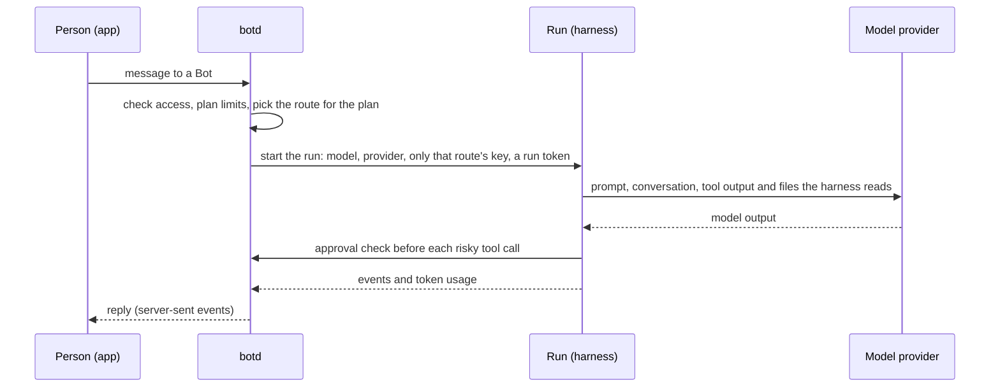
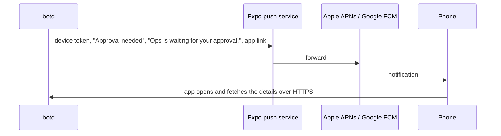
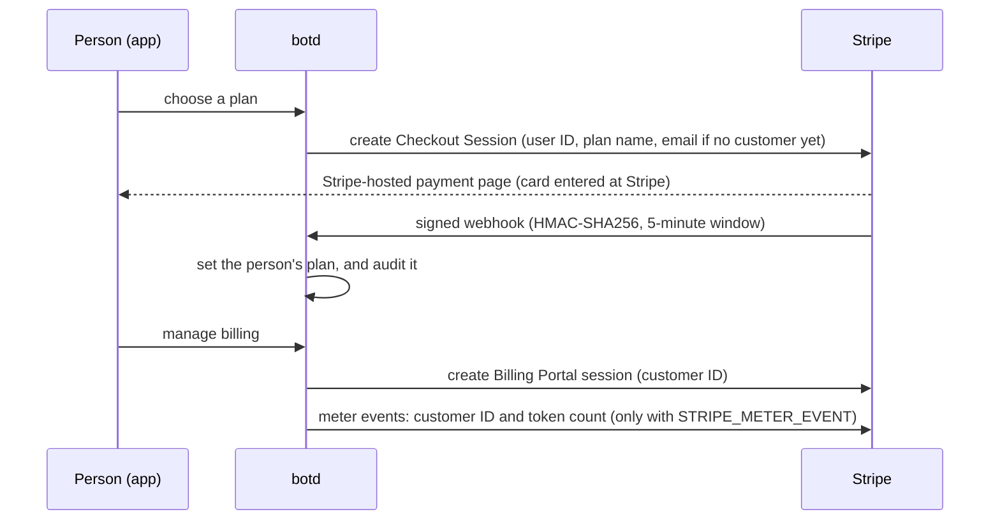

# Data flows

What SuperBot stores, where, how it is protected, and what leaves for outside services. Part of the [security pack](README.md). The parts named here are described in [architecture](architecture.md).

## What is stored where

### On the control plane (botd's server)

botd keeps the organisation's data in one SQLite database, `DATA_DIR/app.sqlite`, plus a few files under `DATA_DIR` ([ADR 0029](../adr/0029-per-user-isolation.md)).

| Data | Stored as |
|------|-----------|
| Users, roles, SSO identities, signup requests, SCIM users | Rows. Users are disabled, never deleted ([ADR 0012](../adr/0012-users-sessions-rbac.md), [ADR 0023](../adr/0023-scim.md)). |
| Sessions, one-time sign-in codes, SCIM tokens, machine enrollment tokens | SHA-256 hashes only. The token itself is never stored. |
| Bot records: owner, visibility, grants, settings, policy rules | Rows. |
| Chat history, routines, approvals | Rows. An approval's tool input is sealed (encrypted, below). Chat text is not sealed. |
| Secrets: server-wide (the "Vault") and each person's own | Sealed ([ADR 0010](../adr/0010-secrets.md), [ADR 0044](../adr/0044-client-personal-secrets.md)). Values are never returned by the API, only names. |
| Push device tokens | Sealed, plus a hash for lookups ([ADR 0080](../adr/0080-client-push-notifications.md)). |
| Audit log | Append-only rows ([ADR 0009](../adr/0009-audit-events.md)). |
| Billing: Stripe customer IDs, subscriptions, usage and token counts | Rows. No card data ([ADR 0040](../adr/0040-billing-v0-tier-limits.md), [ADR 0042](../adr/0042-billing-checkout-portal-customers.md), [ADR 0050](../adr/0050-billing-period-token-usage.md)). |
| Machine records, certificates, backup and restore records | Rows ([ADR 0031](../adr/0031-machine-enrollment-mtls.md), [ADR 0071](../adr/0071-off-host-machine-backups.md)). |
| Each user's facts and Bots' memory, when runs are on this server | Files: `DATA_DIR/users/<id>/USER.md`, `DATA_DIR/bots/<id>/`. |
| Each user's working folder, when runs are on this server | Files: `WORKSPACE_DIR/users/<id>/`, owned by that user's Unix account ([ADR 0058](../adr/0058-harness-os-user-by-default.md)). |
| The master key | A file or environment variable **outside** `DATA_DIR` (`SUPERBOT_MASTER_KEY`, `SUPERBOT_MASTER_KEY_FILE`, or `~/.config/superbot/master.key`). Never in backups. |

### On each user's machine (managed)

| Data | Notes |
|------|-------|
| The user's working folder (`work/`) | Copied once from the server when `MACHINE_FOLDER_SYNC=on`, then lives on the machine ([ADR 0041](../adr/0041-machine-harness-logins-and-folder-copy.md)). |
| Bots' memory and the user's `USER.md` | Seeded from the server where the machine has none. |
| Harness logins (`~/.claude/.credentials.json`, `~/.codex/auth.json`) | Written by the harness's own login on the machine. botd relays the login terminal without saving it or the login files; the audit log records only how many characters were typed. The files are part of the machine's disk, so **machine backups contain them**: Incus backups copy the whole container, homes included, to S3-compatible storage, unencrypted unless `MACHINE_BACKUP_AGE_RECIPIENTS` is set, and Linode Backups hold them too ([ADR 0041](../adr/0041-machine-harness-logins-and-folder-copy.md), [ADR 0062](../adr/0062-teammate-harness-logins.md), [ADR 0071](../adr/0071-off-host-machine-backups.md)). |
| Harness sessions and the Hermes Agent environment | One shared Hermes install per machine, a home per Bot ([ADR 0072](../adr/0072-one-hermes-environment-per-computer.md)). |
| Screens | Live X displays. Nothing is recorded ([ADR 0045](../adr/0045-screens-on-machines.md)). |
| Teammates' homes for shared Bots | Each teammate's own OS user and home, removed when they leave ([ADR 0048](../adr/0048-teammates-own-os-user-on-machines.md), [ADR 0052](../adr/0052-teammate-offboarding-on-machines.md)). |
| The agent's mTLS key and certificate | Issued by botd's CA at enrollment ([ADR 0031](../adr/0031-machine-enrollment-mtls.md)). |

Chat history, approvals, policy, secrets and the audit log stay on the control plane even when runs are on machines.

### On people's devices

| Data | Notes |
|------|-------|
| Session token, server address | iOS and Android: the OS keychain/keystore (`expo-secure-store`). Web: browser storage ([auth review, AUTH-09](auth-review-2026-11.md)). |
| App lock setting | Same store. Optional biometric lock, off by default ([ADR 0078](../adr/0078-client-biometric-app-lock.md)). |
| Chats | In memory only, fetched from botd. Nothing is cached on disk; sign-out clears it. |

## Encryption

### In transit

| Link | Protection |
|------|-----------|
| Device to server | HTTPS, terminated by Caddy (certificates from Caddy's automatic ACME). Caddy to botd is plain HTTP that never leaves the host: loopback with the systemd install, or the Docker Compose network, where botd's port is not published and only Caddy shares the network. Caddy sends a Content-Security-Policy, `X-Content-Type-Options` and `Referrer-Policy`. |
| botd to machine agent, and back | Mutual TLS 1.3 (rustls), with certificates from botd's own Ed25519 CA, 30-day leaf certificates, rotated by the agent, and pinned per machine ([ADR 0031](../adr/0031-machine-enrollment-mtls.md)). Enrollment uses a one-time token. |
| Screens on machines | Inside the same mTLS channel, then to the viewer on the machine's loopback, which checks a per-Bot token ([ADR 0045](../adr/0045-screens-on-machines.md)). |
| Screens on the server | Caddy to the viewer, which checks a per-Bot token: over loopback with the systemd install, or the unpublished Compose network ([ADR 0084](../adr/0084-published-image-with-computer-use.md)). |
| botd to Incus | Mutual TLS, with the Incus host's certificate pinned by SHA-256 ([ADR 0065](../adr/0065-incus-container-machines.md)). |
| botd to Stripe, Expo, Linode, S3, IdPs, webhooks | HTTPS with certificate checks. Webhook and S3 URLs must be HTTPS (plain HTTP only to loopback, for tests). |
| botd to SMTP | STARTTLS by default, or implicit TLS. Plain text only to a relay on the same machine ([ADR 0061](../adr/0061-approval-notifications.md)). |
| Harness to model provider | The harness's own HTTPS client. |

### At rest

| Data | Protection |
|------|-----------|
| Secrets, approval inputs, push tokens | Sealed field by field with XChaCha20-Poly1305 under the master key. Each value is bound to where it lives (for example its user and name), so a copied row doesn't open elsewhere ([`server/src/secrets/sealed.rs`](../../server/src/secrets/sealed.rs), [ADR 0010](../adr/0010-secrets.md)). |
| The rest of the database (chats, audit, users) | **Not encrypted by SuperBot.** Whole-database encryption was considered and rejected ([ADR 0010](../adr/0010-secrets.md)). Protect it with the host's disk encryption. |
| Server backups | Encrypted with age when the operator sets `SUPERBOT_BACKUP_AGE_RECIPIENTS`; otherwise plain archives. The master key is never in them ([ADR 0030](../adr/0030-backup-restore-drill.md)). |
| Machine backups (Incus) | botd receives the container's export from the Incus host over mutual TLS and, when `MACHINE_BACKUP_AGE_RECIPIENTS` is set, encrypts it with age as it streams it to S3-compatible storage. Encryption happens in botd, not on the Incus host, and botd needs only the public keys for it. Without recipients the archive is uploaded unencrypted. To restore an encrypted backup, an admin sends the private age identity to botd with the request; botd uses it for that restore only, decrypts the archive and streams it to the Incus host, and never stores or logs the identity ([ADR 0071](../adr/0071-off-host-machine-backups.md)). |
| Machine disks | Whatever the host provides (Linode, or the Incus host's storage). SuperBot adds no disk encryption. |
| Device | OS keychain/keystore on iOS and Android. |

## Flows to outside services

All are off until the operator sets them up. The full list: [subprocessors](subprocessors.md).

### Model providers, through tier routing

botd never calls a model itself. The **harness** does, from wherever the run is (the server, or the owner's machine).

- **The plan picks the model.** On managed plans, people pick a plan, not a model; a server-side routing table maps each plan to a harness, provider and model, with up to three fallbacks ([ADR 0033](../adr/0033-tiers-model-routing.md), [ADR 0077](../adr/0077-two-providers-through-tier-routing.md), example [`deploy/tiers.example.json`](../../deploy/tiers.example.json)). Self-host plans can leave the choice open (`"routes": "any"`).
- **Keys go only where needed.** A provider key goes only to runs routed to that provider. Hermes Agent removes it from the shell and tools the agent starts. botd's own secrets (Stripe, SMTP, Linode, SSO, and so on) never reach a run.
- **What the provider sees** is whatever the harness sends: the prompt, the conversation, and tool output, including file contents the harness reads. That is governed by the provider's own terms.
- **Harness logins.** A person can sign Claude Code or Codex in with their own subscription on their machine. Those runs go to that provider under the person's own account ([ADR 0041](../adr/0041-machine-harness-logins-and-folder-copy.md)).
- **Usage.** botd records each run's token counts for limits and billing, not the content ([ADR 0050](../adr/0050-billing-period-token-usage.md)).

### Push notifications

Off until `PUSH_PROVIDER=expo`; then each person opts in per phone ([ADR 0080](../adr/0080-client-push-notifications.md)).

A push says only that something is waiting and for which Bot. No command, tool, reason, routine name or output. Access is checked again at send time, a device goes when its session ends, and each person gets at most 30 an hour.

### Email and webhooks (approval notices)

Off until an admin turns a channel on ([ADR 0061](../adr/0061-approval-notifications.md)). A notice holds what the approval card shows: the Bot, the tool, the risk class, the reason, and the command cut short (less with `detail: minimal`). Email goes through the operator's own SMTP server, one message per recipient. Webhooks (Slack-compatible or SuperBot JSON, optionally HMAC-signed) go to a URL the admin saves as a secret.

### Billing (Stripe)

Off until `BILLING=on` and `STRIPE_WEBHOOK_SECRET` are set, and never in testing mode ([ADR 0040](../adr/0040-billing-v0-tier-limits.md), [ADR 0042](../adr/0042-billing-checkout-portal-customers.md), [ADR 0050](../adr/0050-billing-period-token-usage.md)).

- Card details are entered on Stripe's pages and never reach botd.
- The signed webhook is the only way a plan changes. Unsigned, mis-signed or stale events are refused.

### Machines and backups

- **Provisioning.** botd sends the Linode or Incus API a machine's label, tags, region, size and cloud-init data with a one-time enrollment token ([ADR 0035](../adr/0035-machine-firewall-auto-enroll.md)). Incus containers have that data cleared once enrolled ([ADR 0067](../adr/0067-clearing-enrollment-data-from-containers.md)).
- **Runs.** A run's command, environment (including the secrets it needs) and the user's folder copy go to the machine over mTLS. Output comes back as a stream of events.
- **Server backups.** `deploy/superbot-backup.sh` archives `DATA_DIR` daily by default, kept 14 days; default RPO 24 hours, RTO target 1 hour, drilled in CI ([ADR 0030](../adr/0030-backup-restore-drill.md)). Copying archives off the host is the operator's step.
- **Incus machine backups.** Full disk copies to S3-compatible object storage the operator chooses, on a per-plan schedule, with RPO and RTO checked, alerted and drilled. See [machine recovery objectives](machine-recovery-objectives.md) ([ADR 0071](../adr/0071-off-host-machine-backups.md), [ADR 0074](../adr/0074-machine-rpo-and-rto.md), [ADR 0076](../adr/0076-restoring-onto-another-incus-host.md)).
- **Linode machines** use Linode's own backup service (`MACHINE_BACKUPS`, on by default), which the recovery objectives don't cover.

## Retention

| Data | Default |
|------|---------|
| Sessions | End after 7 days idle or 30 days at most (`SESSION_IDLE_TIMEOUT`, `SESSION_MAX_AGE`). |
| Audit log | Kept forever unless `AUDIT_RETENTION_DAYS` is set. |
| Server backups | 14 days (`SUPERBOT_BACKUP_RETENTION_DAYS`). |
| Machine backups | 14 days per plan, the newest of a live machine always kept; a destroyed machine's backups go at the end of their retention. |
| Teammates who leave | Their OS user and home on the owner's machine are removed; work is held aside until purged ([ADR 0052](../adr/0052-teammate-offboarding-on-machines.md)). |

## Planned or not built

- Erasure of a managed user's data (M4, GDPR row of the [roadmap](../ROADMAP.md)). Today users are disabled, not deleted.
- Encryption of the whole database by SuperBot. Rejected for now ([ADR 0010](../adr/0010-secrets.md)); use disk encryption.
- External secret vaults (M5, [ADR 0010](../adr/0010-secrets.md)).
- Contractual data residency. Today the operator picks Linode regions (`MACHINE_REGIONS`) or where Incus hosts are ([ADR 0025](../adr/0025-control-plane-linode.md)); a UK/EU region choice for managed plans is M4, and enterprise dedicated hosting M5 ([roadmap](../ROADMAP.md)).
