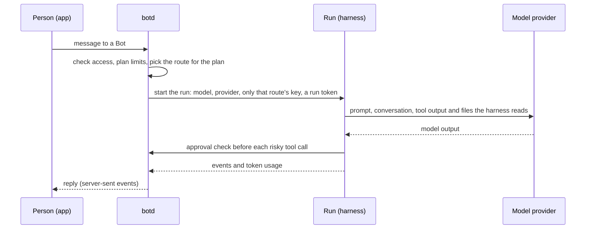
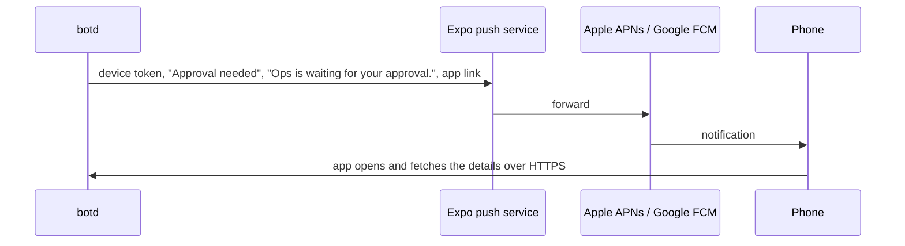
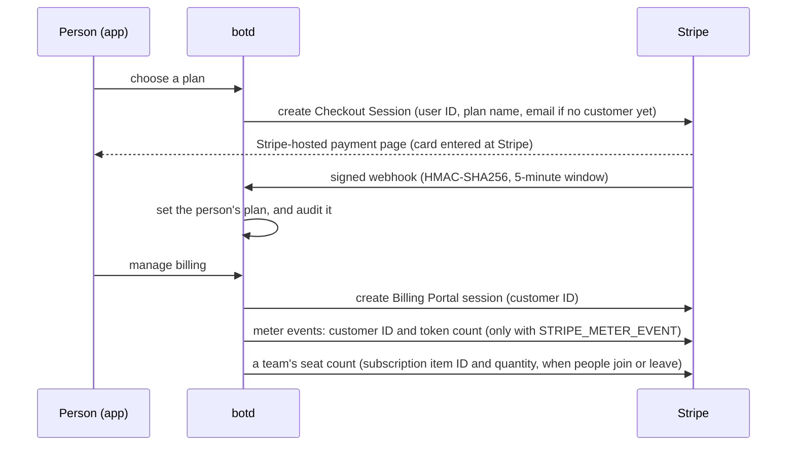

# Data flows

What SuperBot stores, where, how it is protected, and what leaves for outside services. Part of the [security pack](README.md). The parts named here are described in [architecture](architecture.md).

## What is stored where

### On the control plane (botd's server)

botd keeps the organisation's data in one SQLite database, `DATA_DIR/app.sqlite`, encrypted under the master key ([at rest](#at-rest)), plus a few files under `DATA_DIR` ([ADR 0029](../adr/0029-per-user-isolation.md)).

| Data | Stored as |
|------|-----------|
| Users, roles, SSO identities, signup requests, SCIM users | Rows. Users are disabled, never deleted ([ADR 0012](../adr/0012-users-sessions-rbac.md), [ADR 0023](../adr/0023-scim.md)). |
| Teams and their members; SCIM groups | Rows. A SCIM group is a team's link to one IdP tenant: the tenant's name, the IdP's group id (`externalId`) and name ([ADR 0087](../adr/0087-team-accounts-and-machines.md), [ADR 0095](../adr/0095-scim-groups-as-teams.md)). |
| Sessions, one-time sign-in codes, SCIM tokens, machine enrollment tokens | SHA-256 hashes only. The token itself is never stored. A session also keeps the IP address and browser it signed in from. For a pinned person whose region has a chat store, their sessions, with their SAML sign-ins and push devices, are rows in that store instead ([ADR 0283](../adr/0283-sign-ins-in-the-regional-store.md)). |
| Bot records: owner, visibility, grants, settings, policy rules | Rows. |
| Chat history, routines, approvals | Rows. An approval's tool input is sealed (encrypted, below). Chat text is not sealed. Chat history can be deleted by age ([retention](#retention)). |
| Secrets: server-wide (the "Vault") and each person's own | Sealed ([ADR 0010](../adr/0010-secrets.md), [ADR 0044](../adr/0044-client-personal-secrets.md)). Values are never returned by the API, only names. For a pinned person whose region has a chat store, their own secrets are rows in that store instead ([ADR 0293](../adr/0293-own-secrets-in-the-regional-store.md)), and so is their second factor's sealed secret and its recovery codes' hashes ([ADR 0299](../adr/0299-second-factors-in-the-regional-store.md)). Server-wide and botd's own can instead stay in an external secrets manager, and so can each user's with `SECRETS_USER_FOLDERS=1`, read on demand and cached in memory only, never written to botd's database or disk ([ADR 0125](../adr/0125-external-secrets-backend-vault.md), [ADR 0136](../adr/0136-cloud-secret-managers.md), [ADR 0146](../adr/0146-aws-secrets-manager.md), [ADR 0174](../adr/0174-users-secrets-in-the-external-store.md), [below](#external-secret-stores)). |
| Native SAML: SuperBot's keys, IdP metadata, SAML sign-ins | Each provider's signing and encryption keys are sealed in botd's settings, unless the operator gives their own key files ([ADR 0137](../adr/0137-saml-signed-requests-and-single-logout.md), [ADR 0150](../adr/0150-saml-encrypted-assertions.md)). IdP metadata imported with `botctl` is a row; metadata from a URL or a federation is fetched again daily, keeping the last good copy ([ADR 0127](../adr/0127-native-saml-service-provider.md)). Each SAML sign-in keeps the IdP's NameID, its qualifiers and the session index beside the session, for single logout, and goes with the session ([ADR 0137](../adr/0137-saml-signed-requests-and-single-logout.md)). Assertion and logout ids already used are held in memory only. The attributes and groups botd reads become the account's email, identity link and mapped roles, as with OIDC. |
| Push device tokens | Sealed, plus a hash for lookups ([ADR 0080](../adr/0080-client-push-notifications.md)). |
| Audit log | Append-only rows ([ADR 0009](../adr/0009-audit-events.md)). For a pinned person whose region has a chat store, the details of their events (who, IP address, browser, session, what changed) and their salts are rows in that store; botd's log keeps each event's sealed row ([ADR 0316](../adr/0316-audit-details-in-the-regional-store.md)). An event made about a pinned person by someone who isn't held in a store (an admin, say) is kept in the pinned person's store ([ADR 0321](../adr/0321-events-about-a-pinned-person-in-their-store.md)). The audit export sends those events to a SIEM or archive the operator states is outside that region (`AUDIT_EXPORT_DATA_REGION`) as their sealed rows only, details held back ([ADR 0330](../adr/0330-audit-export-held-to-a-pins-region.md)). |
| Billing: Stripe customer IDs, subscriptions, usage and token counts | Rows. No card data ([ADR 0040](../adr/0040-billing-v0-tier-limits.md), [ADR 0042](../adr/0042-billing-checkout-portal-customers.md), [ADR 0050](../adr/0050-billing-period-token-usage.md)); a team's customer, subscription and seat count ([ADR 0093](../adr/0093-team-billing.md)). For a pinned person whose region has a chat store, the per-run usage records of their Bots are rows in that store instead ([ADR 0304](../adr/0304-usage-records-in-the-regional-store.md)). |
| Machine records, certificates, backup and restore records | Rows ([ADR 0031](../adr/0031-machine-enrollment-mtls.md), [ADR 0071](../adr/0071-off-host-machine-backups.md)). |
| Each user's facts and Bots' memory | Files: `DATA_DIR/users/<id>/USER.md`, `DATA_DIR/bots/<id>/`, kept for every run, here or on a machine. For a pinned person whose region has a chat store, rows in that store instead ([ADR 0276](../adr/0276-bots-memory-in-the-regional-store.md), [ADR 0277](../adr/0277-owners-facts-in-the-regional-store.md)). A run on a machine sends the changed files back and botd writes them here (up to 1 MiB each). With per-user accounts, runs here work on a copy in the user's folder, which botd copies back. |
| Each user's working folder, when runs are on this server | Files: `WORKSPACE_DIR/users/<id>/`, owned by that user's Unix account ([ADR 0058](../adr/0058-harness-os-user-by-default.md)). |
| The master key | A file or environment variable **outside** `DATA_DIR` (`SUPERBOT_MASTER_KEY`, `SUPERBOT_MASTER_KEY_FILE`, or `~/.config/superbot/master.key`). Never in backups. It opens the encrypted database as well as the sealed values, so a backup is useless without it. During a rotation, the old key too (`SUPERBOT_MASTER_KEY_PREVIOUS(_FILE)`), until it is removed ([ADR 0096](../adr/0096-master-key-rotation.md)). |

### In a region's chat store (residency pins)

Only with `REGION_DATA_DIRS=<region>=<folder>,...`, which gives each offered region a SQLite store in a folder outside `DATA_DIR`. The operator puts that folder on storage in the region; botd can't see where it is ([ADR 0215](../adr/0215-pinned-chats-in-a-store-in-their-region.md)).

| Data | Stored as |
|------|-----------|
| A pinned person's chats, routines and approvals, their Bots' memory and their own facts | Rows in their pin region's store (their team's pin, else their own), moved there or back after a pin or unpin, at startup and on every reconcile pass, each move audited as `residency.chats_moved`. A move commits the copy before deleting the original ([ADR 0215](../adr/0215-pinned-chats-in-a-store-in-their-region.md), [ADR 0228](../adr/0228-routines-and-approvals-in-the-regional-store.md), [ADR 0276](../adr/0276-bots-memory-in-the-regional-store.md), [ADR 0277](../adr/0277-owners-facts-in-the-regional-store.md)). |
| Their sign-ins (with each device's IP address and browser), native SAML sign-ins, push devices, own secrets, second factor and recovery codes, and per-run usage records | Rows, sealed under the master key where botd's own would be ([ADR 0283](../adr/0283-sign-ins-in-the-regional-store.md), [ADR 0293](../adr/0293-own-secrets-in-the-regional-store.md), [ADR 0299](../adr/0299-second-factors-in-the-regional-store.md), [ADR 0304](../adr/0304-usage-records-in-the-regional-store.md)). |
| The details of audit events about them (who, IP address, browser, session, what changed) | Rows with their salts; botd's log keeps each event's sealed row, so the chain is still one and verifies ([ADR 0316](../adr/0316-audit-details-in-the-regional-store.md), [ADR 0321](../adr/0321-events-about-a-pinned-person-in-their-store.md)). |
| The store's backups | Daily, in the store's own folder (`REGION_DATA_BACKUPS`, 7 by default), never in server backups. Rows moved out are cleared from earlier backups. With `REGION_DATA_S3_<REGION>_*`, mirrored to a bucket in the region, optionally age-encrypted ([ADR 0238](../adr/0238-clearing-moved-rows-from-store-backups.md), [ADR 0246](../adr/0246-copying-store-backups-off-the-host-in-their-region.md)). |

Each store is encrypted with botd's database key, as botd's own database is. Everything else about a pinned person stays in botd's own database, including their account, their Bots' records, daily usage and the sealed rows of their audit events, and server backups keep what they held before a move. A pin's residency report lists each of these as not covered, unless the operator states botd's own data is in the region (`SERVER_DATA_REGION`, [ADR 0184](../adr/0184-botds-own-data-region.md)).

### On each user's machine (managed)

| Data | Notes |
|------|-------|
| The user's working folder (`work/`) | Copied once from the server when `MACHINE_FOLDER_SYNC=on`, then lives on the machine ([ADR 0041](../adr/0041-machine-harness-logins-and-folder-copy.md)). |
| Bots' memory and the user's `USER.md` | Copies of botd's, so both sides hold them. A run takes botd's copy with it (the facts only when none of the owner's other Bots is running there) and sends changes back. A teammate's run gets no `USER.md` and sends none back ([ADR 0046](../adr/0046-shared-bots-under-isolation.md)). |
| Harness logins (`~/.claude/.credentials.json`, `~/.codex/auth.json`) | Written by the harness's own login on the machine. botd relays the login terminal without saving it or the login files; the audit log records only how many characters were typed. The files are part of the machine's disk, so **machine backups contain them**: Incus backups copy the whole container, homes included, to S3-compatible storage, unencrypted unless `MACHINE_BACKUP_AGE_RECIPIENTS` is set, and Linode Backups hold them too ([ADR 0041](../adr/0041-machine-harness-logins-and-folder-copy.md), [ADR 0062](../adr/0062-teammate-harness-logins.md), [ADR 0071](../adr/0071-off-host-machine-backups.md)). |
| Harness sessions and the Hermes Agent environment | One shared Hermes install per machine, a home per Bot ([ADR 0072](../adr/0072-one-hermes-environment-per-computer.md)). |
| Screens | Live X displays. Nothing is recorded ([ADR 0045](../adr/0045-screens-on-machines.md)). |
| Teammates' homes for shared Bots | With `MACHINE_TEAMMATE_USERS=on` (off by default), each teammate's own OS user and home, removed when they leave ([ADR 0048](../adr/0048-teammates-own-os-user-on-machines.md), [ADR 0052](../adr/0052-teammate-offboarding-on-machines.md)). |
| The agent's mTLS key and certificate | Issued by botd's CA at enrollment ([ADR 0031](../adr/0031-machine-enrollment-mtls.md)). |

Chat history, approvals, policy, secrets and the audit log stay on the control plane (botd's database, or a region's chat store) even when runs are on machines.

### On people's devices

| Data | Notes |
|------|-------|
| Session token, server address | iOS and Android: the OS keychain/keystore (`expo-secure-store`). Web: browser storage ([auth review, AUTH-09](auth-review-2026-11.md)). |
| App lock setting | Same store. Optional biometric lock, off by default ([ADR 0078](../adr/0078-client-biometric-app-lock.md)). |
| Chats | In memory only, fetched from botd. Nothing is cached on disk; sign-out clears it. |

## Encryption

### In transit

| Link | Protection |
|------|-----------|
| Device to server | HTTPS, terminated by Caddy (certificates from Caddy's automatic ACME). Caddy to botd is plain HTTP that never leaves the host: loopback with the systemd install, or the Docker Compose network, where botd's port is not published and only Caddy shares the network. Caddy sends a Content-Security-Policy, `X-Content-Type-Options` and `Referrer-Policy`. |
| botd to machine agent, and back | Mutual TLS 1.3 (rustls), with certificates from botd's own Ed25519 CA, 30-day leaf certificates, rotated by the agent, and pinned per machine ([ADR 0031](../adr/0031-machine-enrollment-mtls.md)). Enrollment uses a one-time token. |
| Screens on machines | Inside the same mTLS channel, then to the viewer on the machine's loopback, which checks a per-Bot token ([ADR 0045](../adr/0045-screens-on-machines.md)). |
| Screens on the server | Caddy to the viewer, which checks a per-Bot token: over loopback with the systemd install, or the unpublished Compose network ([ADR 0084](../adr/0084-published-image-with-computer-use.md)). |
| botd to Incus | Mutual TLS, with the Incus host's certificate pinned by SHA-256 ([ADR 0065](../adr/0065-incus-container-machines.md)). |
| botd to Stripe, Expo, Linode, S3, IdPs, webhooks | HTTPS with certificate checks. Webhook and S3 URLs must be HTTPS (plain HTTP only to loopback, for tests). |
| botd to an error tracker | Off unless `ERROR_REPORT_DSN` is set. HTTPS with certificate checks (plain HTTP only to loopback). Reports hold route templates, statuses, source locations, request ids and botd's version; never a prompt, chat, path as sent, body or user ([ADR 0113](../adr/0113-service-dashboards-and-error-reporting.md)). |
| botd to SMTP | STARTTLS by default, or implicit TLS. Plain text only to a relay on the same machine ([ADR 0061](../adr/0061-approval-notifications.md)). |
| botd to a SAML IdP | Metadata URLs, MDQ servers and federation aggregates over HTTPS, with the metadata's signature checked when the operator gives the signer's certificate ([ADR 0151](../adr/0151-saml-encrypted-nameids-ecdsa-and-signed-metadata.md), [ADR 0281](../adr/0281-saml-metadata-from-mdq.md)). SOAP logout and artifact resolution only to HTTPS endpoints the IdP's metadata lists ([ADR 0208](../adr/0208-saml-back-channel-soap-logout.md), [ADR 0268](../adr/0268-saml-artifact-binding.md)). Assertions that pass through the browser are signed, and encrypted when the operator turns that on ([ADR 0150](../adr/0150-saml-encrypted-assertions.md)). |
| botd to an external secrets store | HTTPS with certificate checks; Vault may use a private CA (`VAULT_CACERT`), and plain HTTP only to loopback, for a local Vault Agent ([ADR 0125](../adr/0125-external-secrets-backend-vault.md)). |
| botd to SIEMs and the audit archive | SIEMs: HTTPS or syslog over TLS; plain HTTP or TCP only to loopback unless `AUDIT_EXPORT_INSECURE=on`, for a collector on a private network ([ADR 0122](../adr/0122-siem-export-and-tamper-evident-audit.md)). The archive: its S3 endpoint over HTTPS, or plain HTTP only to loopback ([ADR 0154](../adr/0154-write-once-s3-audit-archive.md)). Optional gzip ([ADR 0227](../adr/0227-gzip-for-the-audit-export.md)). |
| botd to users' machines, for harness and Hermes bundles and npm logins on an air-gapped network | Inside the machine port's mutual TLS. Each bundle is checked on the machine before use; an npm login is written for root alone and removed after the install ([ADR 0242](../adr/0242-harness-bundle-on-air-gapped-machines.md), [ADR 0210](../adr/0210-hermes-agent-on-air-gapped-machines.md), [ADR 0219](../adr/0219-npm-registry-logins-for-air-gapped-machines.md)). |
| Harness to model provider | The harness's own client, to the provider's URL. A provider in the plan routing file (`TIERS_FILE`) and `SUPERBOT_HERMES_BASE_URL` must be `https://`, or plain `http://` only to this host (`127.0.0.0/8`, `::1`, `localhost`); botd refuses to start otherwise ([ADR 0097](../adr/0097-model-providers-over-https.md)). Hermes Agent, Claude Code and Codex routes can name one; its key goes to the harness in its environment, never its command line ([ADR 0192](../adr/0192-in-region-claude-code-and-codex-routes.md)). An endpoint the operator or a user gives a harness in its own settings (`ANTHROPIC_BASE_URL`, a Bot's Codex or Pi config) is theirs to keep on HTTPS. |

### At rest

| Data | Protection |
|------|-----------|
| Secrets, approval inputs, push tokens | Sealed field by field with XChaCha20-Poly1305 under the master key. Each value is bound to where it lives (for example its user and name), so a copied row doesn't open elsewhere ([`server/src/secrets/sealed.rs`](../../server/src/secrets/sealed.rs), [ADR 0010](../adr/0010-secrets.md)). |
| The whole database (chats, audit, users, Bot settings), its WAL, and the copy in each backup | Encrypted with SQLCipher 4 (AES-256, an HMAC per page) under a key derived from the master key with HMAC-SHA256 ([`server/src/database_encryption.rs`](../../server/src/database_encryption.rs), [ADR 0116](../adr/0116-database-encrypted-at-rest.md)). Required on new installs; an existing plain database stays plain until `SUPERBOT_DATABASE_ENCRYPTION=required`, which encrypts it and keeps a plain copy in `DATA_DIR` until the operator deletes it; `off` keeps it plain by choice. A plain database or a plain copy is shown in the startup log, the setup checklist, `botctl database` and `/metrics`, and audited. It doesn't protect against code running as botd's user or root on the host, which can read the key. |
| A region's chat store and its backups | Encrypted with SQLCipher under botd's database key, like the database; secrets, push tokens, second factors and approval inputs in it are also sealed under the master key ([ADR 0215](../adr/0215-pinned-chats-in-a-store-in-their-region.md), [ADR 0293](../adr/0293-own-secrets-in-the-regional-store.md)). Copies in the region's bucket are encrypted with age when the operator sets recipients ([ADR 0246](../adr/0246-copying-store-backups-off-the-host-in-their-region.md)). |
| Secrets in an external store | Kept and encrypted by that store, under the customer's own policies. botd holds values in memory only, for `SECRETS_CACHE_SECONDS` ([ADR 0125](../adr/0125-external-secrets-backend-vault.md)). |
| The audit archive | By default each object is locked with S3 Object Lock, by the bucket's default retention or in compliance or governance mode, and botd reads every lock back. In compliance mode nobody, the account's root included, can shorten the lock or delete a locked version before it ends; in governance mode someone with the bypass right can. `AUDIT_EXPORT_S3_LOCK=off` writes to a plain bucket instead. Encryption is the bucket's ([ADR 0154](../adr/0154-write-once-s3-audit-archive.md)). |
| Files in `DATA_DIR` (Bots' memory, `USER.md`) and the workspace | **Not encrypted by SuperBot.** Protect them with the host's disk encryption. |
| Server backups | Encrypted with age when the operator sets `SUPERBOT_BACKUP_AGE_RECIPIENTS`; otherwise plain archives. The master key is never in them ([ADR 0030](../adr/0030-backup-restore-drill.md)). Copies off the host are those archives as they are, or, for plain ones, encrypted by botd as it streams them when `SERVER_BACKUP_AGE_RECIPIENTS` is set ([ADR 0109](../adr/0109-server-backups-off-the-host.md)). |
| Machine backups (Incus) | botd receives the container's export from the Incus host over mutual TLS and, when `MACHINE_BACKUP_AGE_RECIPIENTS` is set, encrypts it with age as it streams it to S3-compatible storage. Encryption happens in botd, not on the Incus host, and botd needs only the public keys for it. Without recipients the archive is uploaded unencrypted. To restore an encrypted backup, an admin sends the private age identity to botd with the request; botd uses it for that restore only, decrypts the archive and streams it to the Incus host, and never stores or logs the identity ([ADR 0071](../adr/0071-off-host-machine-backups.md)). |
| Machine disks | Whatever the host provides (Linode, or the Incus host's storage). SuperBot adds no disk encryption. |
| Device | OS keychain/keystore on iOS and Android. |

## Flows to outside services

All are off until the operator sets them up. The full list: [subprocessors](subprocessors.md).

### Model providers, through tier routing

botd never calls a model itself. The **harness** does, from wherever the run is (the server, or the owner's machine).



- **The plan picks the model.** On managed plans, people pick a plan, not a model; a server-side routing table maps each plan to a harness, provider and model, with up to three fallbacks ([ADR 0033](../adr/0033-tiers-model-routing.md), [ADR 0077](../adr/0077-two-providers-through-tier-routing.md), example [`deploy/tiers.example.json`](../../deploy/tiers.example.json)). Self-host plans can leave the choice open (`"routes": "any"`).
- **Keys go only where needed.** A provider key goes only to runs routed to that provider. Hermes Agent removes it from the shell and tools the agent starts. botd's own secrets (Stripe, SMTP, Linode, SSO, and so on) never reach a run.
- **What the provider sees** is whatever the harness sends: the prompt, the conversation, and tool output, including file contents the harness reads. That is governed by the provider's own terms.
- **Harness logins.** A person can sign Claude Code or Codex in with their own subscription on their machine. Those runs go to that provider under the person's own account ([ADR 0041](../adr/0041-machine-harness-logins-and-folder-copy.md)).
- **Region.** Model calls are processed where the provider and endpoint in the plan's routes process them. A data region alone doesn't change the route. A residency pin does: the tiers file marks each endpoint's `regions`, and a pinned user's or team's runs (or a run they ask for) take only a route whose endpoint is marked as in their region, keep only fallbacks that are, and are refused with `bot.run_refused` (reason `residency_pinned`) otherwise. With Hermes Agent, side tasks use the run's endpoint and the built-in providers' keys are left out ([ADR 0139](../adr/0139-in-region-model-routes.md), [DPA Annex IV.4](dpa-template.md#iv4-model-providers)). The mark is the operator's word; botd can't see where an endpoint processes.
- **Usage.** botd records each run's token counts for limits and billing, not the content ([ADR 0050](../adr/0050-billing-period-token-usage.md)).

### Push notifications

Off until `PUSH_PROVIDER=expo`; then each person opts in per phone ([ADR 0080](../adr/0080-client-push-notifications.md)).



A push says only that something is waiting and for which Bot. No command, tool, reason, routine name or output. Access is checked again at send time, a device goes when its session ends, and each person gets at most 30 an hour.

### Email and webhooks (approval notices)

Off until an admin turns a channel on ([ADR 0061](../adr/0061-approval-notifications.md)). A notice holds what the approval card shows: the Bot, the tool, the risk class, the reason, and the command cut short (less with `detail: minimal`). Email goes through the operator's own SMTP server, one message per recipient. Webhooks (Slack-compatible or SuperBot JSON, optionally HMAC-signed) go to a URL the admin saves as a secret. The same channels carry server alerts to the global list only; a suspicious sign-in alert names the account (its email) and how they signed in, never the IP, which stays in the audit log ([ADR 0104](../adr/0104-suspicious-sign-in-alerts.md)).

### Billing (Stripe)

Off until `BILLING=on` and `STRIPE_WEBHOOK_SECRET` are set, and never in testing mode ([ADR 0040](../adr/0040-billing-v0-tier-limits.md), [ADR 0042](../adr/0042-billing-checkout-portal-customers.md), [ADR 0050](../adr/0050-billing-period-token-usage.md), [ADR 0093](../adr/0093-team-billing.md)).



- Card details are entered on Stripe's pages and never reach botd.
- The signed webhook is the only way a plan changes. Unsigned, mis-signed or stale events are refused.
- A team's plan is bought by its owners and admins for everyone on it. Stripe gets the team's ID, the buyer's user ID and email (for a new customer), and the number of members, never their names or emails. The team's Stripe customer is never a person's.
- Billing emails go through the operator's SMTP server to the person the plan is for, as plain text: their plan name and dates, what their computer is doing about a plan change, and how close they are to their tier's tokens and storage. Never a Stripe id, price, amount, card detail, portal link or secret. Off unless billing and SMTP are on ([ADR 0091](../adr/0091-billing-emails.md)). A team plan's emails go to the team's owners and admins ([ADR 0093](../adr/0093-team-billing.md)).

### Identity providers (SCIM, inbound)

Off until `SCIM=on` ([ADR 0023](../adr/0023-scim.md), [ADR 0026](../adr/0026-scim-review-hardening.md)). The IdP calls botd at `/scim/v2` with a tenant's bearer token; for SCIM, botd never calls the IdP (Google Workspace's directory sync, below, is the exception). It sends people's names, emails, the IdP's ids for them, whether they're active, their Enterprise User attributes (employee number, cost center, organization, division, department, and manager, kept only when the manager is in the same tenant; [ADR 0176](../adr/0176-scim-enterprise-user-extension.md)), and with `SCIM_GROUPS=on`, group names, the IdP's group ids, and members ([ADR 0095](../adr/0095-scim-groups-as-teams.md); role groups too, [ADR 0180](../adr/0180-scim-role-groups.md)).

- A tenant sees and changes only the users it provisioned and the groups it made or an admin linked to it. It never gets anyone else's data back: a group's `members` lists only the tenant's own people.
- Group membership moves people onto and off teams, which changes who shares their Bots, which machines they get, and which plan they're on; leaving runs the same offboarding as a team admin's removal. SCIM never sets a role.
- Enterprise User attributes are shown to admins and in the access review, and never decide access.
- Everything it sends that SuperBot doesn't keep (roles, phone numbers, Okta's placeholder password) is dropped, never stored or logged. Every change is in the audit log with the token as the actor.
- A SCIM `DELETE` disables the user and keeps their data (a soft delete). Erasing them is an admin's separate step, after which the tenant sees 404 and provisioning them again makes a new user ([ADR 0102](../adr/0102-erasing-a-users-data.md)).
- Google Workspace is the exception: it pushes SCIM only to its catalog apps, so with `GOOGLE_DIRECTORY_SYNC=on` (off by default) botd reads users, groups and organizational units from Google's Directory API itself, through the same handlers and rules ([ADR 0162](../adr/0162-google-workspace-directory-sync.md), [ADR 0274](../adr/0274-scim-provisioning-delivered.md)).

### Identity providers (native SAML)

Off until the operator sets up a `saml` provider without `ISSUER` ([ADR 0127](../adr/0127-native-saml-service-provider.md), [guide](../sso/saml-native.md)).

```mermaid
sequenceDiagram
  participant P as Person's browser
  participant B as botd
  participant I as SAML IdP
  B->>I: fetch metadata (URL, MDQ or federation aggregate), daily
  P->>B: sign in with the IdP
  B-->>P: AuthnRequest (optionally signed), a binder cookie
  P->>I: AuthnRequest
  I-->>P: signed response (optionally encrypted), or only an artifact
  P->>B: response or artifact
  B->>I: ArtifactResolve, signed (artifact binding only)
  B->>B: check signature, request, audience, time, MFA, groups; map roles
  B-->>P: SuperBot session
  B->>I: signed LogoutRequest at sign-out or revocation (SOAP, where offered)
```

- **What the IdP sends**: the NameID or a subject identifier, the email and name attributes botd is told to read, and, when configured, groups, how the person signed in, and identity assurance values. botd keeps the identity link, email and name on the account, the NameID and session index beside the session, and roles from mapped groups; botd doesn't store the assertion itself ([ADR 0160](../adr/0160-saml-groups-and-role-mapping.md), [ADR 0319](../adr/0319-saml-subject-identifier-attributes.md)). Each sign-in's `auth.login` event records how it was checked, such as the authentication context and binding.
- **What botd sends the IdP**: AuthnRequests and LogoutRequests naming SuperBot and, for logout, the person's NameID and session index. Nothing else about the person.
- **SP metadata**: botd publishes its entity ID, endpoints and public certificates, and, if the operator sets them, display names, contacts and the Sirtfi assertion a federation registers ([ADR 0323](../adr/0323-saml-sp-metadata-for-federation-registration.md)).

### External secret stores

Off until `SECRETS_BACKEND` is `vault`, `azure-keyvault`, `gcp-secret-manager` or `aws` ([ADR 0125](../adr/0125-external-secrets-backend-vault.md), [ADR 0136](../adr/0136-cloud-secret-managers.md), [ADR 0146](../adr/0146-aws-secrets-manager.md)).

- **botd sends** its sign-in (a Vault token or AppRole, a platform token or signed cloud identity, a client secret or certificate assertion) to the store or the cloud's identity endpoint, and the names it reads. It never writes a value ([ADR 0159](../adr/0159-vault-kubernetes-and-jwt-sign-in.md), [ADR 0260](../adr/0260-vault-cloud-sign-in.md), [ADR 0269](../adr/0269-azure-certificate-credentials.md)).
- **botd receives** the values of names it uses: Bots' server-wide keys, its own settings' secrets and, with `SECRETS_USER_FOLDERS=1`, each user's. They are cached in memory for `SECRETS_CACHE_SECONDS` and given to runs as their environment, like sealed secrets. A user's values reach only Bots that user owns ([ADR 0174](../adr/0174-users-secrets-in-the-external-store.md)).
- **Change events**, when on: botd pulls GCP's Pub/Sub subscription or follows Vault's event stream, reading only which secret changed, then reads it again ([ADR 0306](../adr/0306-following-vaults-change-events.md), [ADR 0325](../adr/0325-following-gcp-secret-managers-change-events.md)).
- **Short-lived run credentials**, when on: botd asks Vault, AWS STS, GCP IAM Credentials or Entra ID for credentials as each run starts, and gives them to that run only. A Bot's and its owner's ids may be sent as session names, tags or paths, for the cloud's own logs and policies ([ADR 0185](../adr/0185-short-lived-credentials-per-run.md), [ADR 0194](../adr/0194-sts-sessions-for-each-run.md), [ADR 0203](../adr/0203-gcp-service-account-tokens-for-each-run.md), [ADR 0213](../adr/0213-entra-app-tokens-for-each-run.md), [ADR 0230](../adr/0230-session-policies-and-tags-for-each-run.md)).
- The store's region is the customer's choice; GCP Secret Manager's regional secrets can keep values in one region ([ADR 0136](../adr/0136-cloud-secret-managers.md)).

### Audit export

Off until `AUDIT_EXPORT` names one or more sinks ([ADR 0122](../adr/0122-siem-export-and-tamper-evident-audit.md), [guide](../ops/audit-export.md)).

- **What goes**: every audit event as the audit API shows it, with its place on the hash chain (`chainPrev`, `chainHash`, and the digest and salt that let a line check itself), and the signed checkpoints and their timestamps as events of their own ([ADR 0149](../adr/0149-signed-and-timestamped-audit-checkpoints.md), [ADR 0199](../adr/0199-self-checking-audit-lines.md)). An event names its actor and target with their emails, the IP address and browser, the session and what changed ([ADR 0019](../adr/0019-audit-actors.md)). Secrets are redacted when an event is written, and tokens and passwords are never recorded, so none can go out. An erased event goes without its salt.
- **Where**: up to four SIEMs (an HTTPS webhook, syslog over TLS, Microsoft Sentinel through Azure Monitor, Google SecOps, Datadog) and one S3 archive, each the operator's choice and region ([ADR 0191](../adr/0191-several-siems-with-their-own-headers.md), [ADR 0217](../adr/0217-audit-export-to-azure-monitor.md), [ADR 0237](../adr/0237-audit-export-to-google-secops.md), [ADR 0245](../adr/0245-audit-export-to-datadog.md), [ADR 0154](../adr/0154-write-once-s3-audit-archive.md)). Sentinel and SecOps sinks sign in as botd's own Azure or Google identity; the others use the headers or keys the operator saves as server secrets.
- **Residency**: a sink the operator states is outside a pinned person's region (`AUDIT_EXPORT_DATA_REGION`) gets their events as sealed rows, details held back. A sink with no stated region gets everything, and the pin's report names it as not covered ([ADR 0330](../adr/0330-audit-export-held-to-a-pins-region.md)).
- **Timestamps**: with `AUDIT_TIMESTAMP_URL`, botd sends a time-stamping authority the hash of each checkpoint, never an event ([ADR 0149](../adr/0149-signed-and-timestamped-audit-checkpoints.md)).

### Machines and backups

- **Provisioning.** botd sends the Linode or Incus API a machine's label, tags, region, size and cloud-init data with a one-time enrollment token ([ADR 0035](../adr/0035-machine-firewall-auto-enroll.md)). Incus containers have that data cleared once enrolled ([ADR 0067](../adr/0067-clearing-enrollment-data-from-containers.md)).
- **Data regions.** A server admin can set a data region, such as London (`gb-lon`) or Frankfurt (`de-fra-2`), for a user or a team from the operator's `MACHINE_REGIONS`. A user's own region wins over their team's, and the team's over the default. Machines are made only in that region: a Linode there, or an Incus container only on a host tagged with it. Their off-host backups go to that region's store. A request, restore or placement elsewhere is refused, and so is a region change while a machine is still elsewhere; each change and refusal is audited ([ADR 0117](../adr/0117-uk-eu-data-regions.md)). botd's own database and server backups stay where botd runs.
- **Residency pins.** A server admin can pin a user or a team to their region under an agreement reference. Then their region can't change, a pinned team takes no member with data elsewhere, backups go only to a store in the region (even with `MACHINE_BACKUP_RESIDENCY=warn`), and a restore, move or lost-host recovery needs both the backup and the host in the region. Each refusal is audited as `machine.residency_refused`; pins are refused while any of their data is elsewhere, and unpinning needs a reason ([ADR 0129](../adr/0129-contractual-data-residency.md)). Their Bots' runs take only model routes whose endpoint the tiers file marks as in the region ([model providers](#model-providers-through-tier-routing), [ADR 0139](../adr/0139-in-region-model-routes.md)). With `REGION_DATA_DIRS`, a pin also moves the person's chats, sign-ins, own secrets, audit details and the rest of the data [above](#in-a-regions-chat-store-residency-pins) into the region's chat store. The rest of botd's own data stays where botd runs; the operator states its region (`SERVER_DATA_REGION`, and where server backups are copied), residency reports show whether it is in the pin's region, and `RESIDENCY_SERVER_DATA=require` holds every pin to it ([ADR 0184](../adr/0184-botds-own-data-region.md)).
- **Residency reports.** A report on a pin says where its data is now, what the pin refused in a period, and what it doesn't cover (such as an audit sink with no stated region), sealed with a SHA-256 digest a customer can check with `jq` and `sha256sum`. Admins get any pin's report; people see the pin on their own data in the app, and a team's owners and admins get the team's report ([ADR 0155](../adr/0155-residency-reports.md), [ADR 0168](../adr/0168-residency-in-the-app.md), [ADR 0330](../adr/0330-audit-export-held-to-a-pins-region.md)).
- **Runs.** A run's command, environment (including the secrets it needs) and the user's folder copy go to the machine over mTLS. Output comes back as a stream of events.
- **Server backups.** `deploy/superbot-backup.sh` archives `DATA_DIR` daily by default, kept 14 days; default RPO 24 hours, RTO target 1 hour, drilled in CI ([ADR 0030](../adr/0030-backup-restore-drill.md)). botd copies each archive to S3-compatible storage the operator chooses (`SERVER_BACKUP_S3_*`, else the machine backups' store, under `server/`) within a minute, with a manifest, and alerts past an RPO of the archive interval plus 2 hours; without a store archives stay on the host and botd warns about it ([ADR 0109](../adr/0109-server-backups-off-the-host.md)).
- **Incus machine backups.** Full disk copies to S3-compatible object storage the operator chooses (one store per data region where set, [ADR 0117](../adr/0117-uk-eu-data-regions.md)), on a per-plan schedule, with RPO and RTO checked, alerted and drilled. See [machine recovery objectives](machine-recovery-objectives.md) ([ADR 0071](../adr/0071-off-host-machine-backups.md), [ADR 0074](../adr/0074-machine-rpo-and-rto.md), [ADR 0076](../adr/0076-restoring-onto-another-incus-host.md)).
- **Linode machines** use Linode's own backup service (`MACHINE_BACKUPS`, on by default), held to an RPO that botd checks and alerts on from what the Linode API says of each machine's last successful backup. See [machine recovery objectives](machine-recovery-objectives.md#linode-machines) ([ADR 0110](../adr/0110-linode-machine-recovery-objectives.md)).

### Air-gapped installs

On a network with no internet access ([ADR 0128](../adr/0128-air-gapped-self-host.md), [guide](../ops/air-gapped.md)), nothing on this page needs to leave it:

- Nothing on the server calls GitHub, a package registry, Let's Encrypt or CG-Labs, and the licence is checked offline ([ADR 0038](../adr/0038-self-host-license-key.md)).
- Software comes in as signed, checked bundles that the operator carries in; botd hands machines their harness and Hermes bundles over mutual TLS, and an npm registry's login, when one is needed, only for the install that uses it, audited by kind as `machine.npm_login_sent`, never its value ([ADR 0219](../adr/0219-npm-registry-logins-for-air-gapped-machines.md)).
- Every outside service must be one inside the network or off: the IdP, model providers, SMTP, the S3-compatible store, SIEMs, the secrets store. `botd offline check` and `botctl offline check` list each address botd's settings and secrets name that would reach the internet, showing only hosts, never a secret's value ([ADR 0257](../adr/0257-checking-settings-for-air-gapped-networks.md), [ADR 0266](../adr/0266-checking-the-running-server-for-air-gapped-networks.md)).

## Retention

| Data | Default |
|------|---------|
| Sessions | End after 7 days idle or 30 days at most (`SESSION_IDLE_TIMEOUT`, `SESSION_MAX_AGE`). |
| Audit log | Kept forever unless `AUDIT_RETENTION_DAYS` is set; with an audit export, no event is pruned before every sink has it ([ADR 0122](../adr/0122-siem-export-and-tamper-evident-audit.md)). |
| Exported audit events | Set by each SIEM's own retention, and the archive's locks or bucket rules. botd never deletes from them, and an erasure doesn't reach copies already exported ([ADR 0122](../adr/0122-siem-export-and-tamper-evident-audit.md), [ADR 0154](../adr/0154-write-once-s3-audit-archive.md)). |
| A region's chat store | The same rules as above: retention deletes and erasure run on every store ([ADR 0215](../adr/0215-pinned-chats-in-a-store-in-their-region.md)). Each store is backed up daily into its own folder, keeping the newest 7 (`REGION_DATA_BACKUPS`); rows that move out of a store are cleared from its earlier backups within the hour ([ADR 0238](../adr/0238-clearing-moved-rows-from-store-backups.md)). |
| Chat history | Kept forever unless `CHAT_RETENTION_DAYS` is set; then older messages are deleted when botd starts and every 6 hours, in batches, and each pass that deletes any is audited (`chat.pruned`) with the count, never the text. Never deleted: a message whose run is still queued or running, and the chat of a Bot an admin holds (a legal hold, `botctl retention hold`), which can't be deleted while held, nor can a Bot it wrote to ([ADR 0098](../adr/0098-chat-retention.md)). Bots' memory isn't covered. |
| Harness session files | Kept forever unless `HARNESS_SESSION_RETENTION_DAYS` is set; then sessions nothing has changed for that long are deleted when botd starts and every 6 hours: Claude Code's and Codex's in the HOME their runs use (botd's, each per-user account's, or the Bots' HOME and teammates' homes on a machine), Pi's in each Bot's folder, and Hermes Agent's from its database by Hermes itself. botd sweeps per-user accounts as the account and machines through their agent. Never a running Bot's session, never a held Bot's folder, and nothing in a HOME where a held Bot runs; Claude Code is told to keep its own as long. Each pass that deletes is audited (`harness_sessions.pruned`) with its counts ([ADR 0112](../adr/0112-harness-session-and-teammate-files-retention.md)). |
| Teammates' archived work | A leaving teammate's work archived to the owner's `from-teammates/` folder is kept forever unless `TEAMMATE_FILES_RETENTION_DAYS` is set; then it is deleted that long after it was archived, on the machine or as the owner's account, unless one of the owner's Bots is held, and each pass that deletes is audited (`teammate_files.pruned`) ([ADR 0112](../adr/0112-harness-session-and-teammate-files-retention.md)). With `*_TEAMMATE_FILES=delete` it is deleted after a grace period instead of archived. |
| Erased users | An admin erases a user on request (`botctl user erase`): their Bots, chats, routines, sign-ins, second factor, sealed secrets and botd's folders for them are deleted at once, what they sent in others' chats becomes `[erased]`, and the user row stays with no personal data. Audit events stay, naming them by a random pseudonym. Refused under a legal hold. Their machines' backups go too when the admin asks (`--delete-backups`); otherwise the erasure is refused while any are kept ([ADR 0108](../adr/0108-deleting-a-destroyed-machines-backups.md)). Left: their per-user isolation folder (the operator removes the OS user), server backups until their retention ends, and Stripe's billing records ([ADR 0102](../adr/0102-erasing-a-users-data.md)). |
| Server backups | 14 days on the host (`SUPERBOT_BACKUP_RETENTION_DAYS`); copies off the host 30 days (`SERVER_BACKUP_RETENTION_DAYS`, or `off` for the bucket's own rules), the newest always kept. Deleted chat and audit rows stay in backups until then. |
| Machine backups | 14 days per plan, the newest of a live machine always kept; a destroyed machine's backups go at the end of their retention, or at once when an admin asks (`botctl machine delete-backups`, audited, [ADR 0108](../adr/0108-deleting-a-destroyed-machines-backups.md)). |
| Teammates who leave | Their OS user and home on the owner's machine (or their account for the owner's Bots on one server) are removed. Their work is handed to the owner's `from-teammates/` folder and then kept as the owner's files (`MACHINE_TEAMMATE_FILES=archive`, `ISOLATION_TEAMMATE_FILES=archive`, the defaults), or held aside and deleted after `*_TEAMMATE_FILES_DAYS` with `delete` ([ADR 0052](../adr/0052-teammate-offboarding-on-machines.md), [ADR 0066](../adr/0066-removing-teammate-accounts-on-one-server.md)). `TEAMMATE_FILES_RETENTION_DAYS` deletes archived work by age (above). |

## Planned or not built

- Erasing a user's data from server backups and their per-user isolation folder ([ADR 0102](../adr/0102-erasing-a-users-data.md) covers everything else, and [ADR 0108](../adr/0108-deleting-a-destroyed-machines-backups.md) their machines' backups).
- Encryption by SuperBot of the files beside the database (Bots' memory, `USER.md`) and the workspace; use disk encryption. The database itself is encrypted ([ADR 0116](../adr/0116-database-encrypted-at-rest.md)).
- Accounts by region. Under a residency pin, the account, its Bots' records, daily usage and the sealed rows of audit events stay in botd's own database, wherever it runs ([ADR 0321](../adr/0321-events-about-a-pinned-person-in-their-store.md)); `SERVER_DATA_REGION` with `RESIDENCY_SERVER_DATA=require`, or one botd per region, covers that ([ADR 0184](../adr/0184-botds-own-data-region.md)).
- Erasing audit events already exported. A SIEM's or the archive's copies are kept under their own retention, and the operator's DPA covers them ([ADR 0122](../adr/0122-siem-export-and-tamper-evident-audit.md)).
- Writing to an external secrets store. botd only reads; values are added and rotated in the store's own tools ([ADR 0125](../adr/0125-external-secrets-backend-vault.md)).
